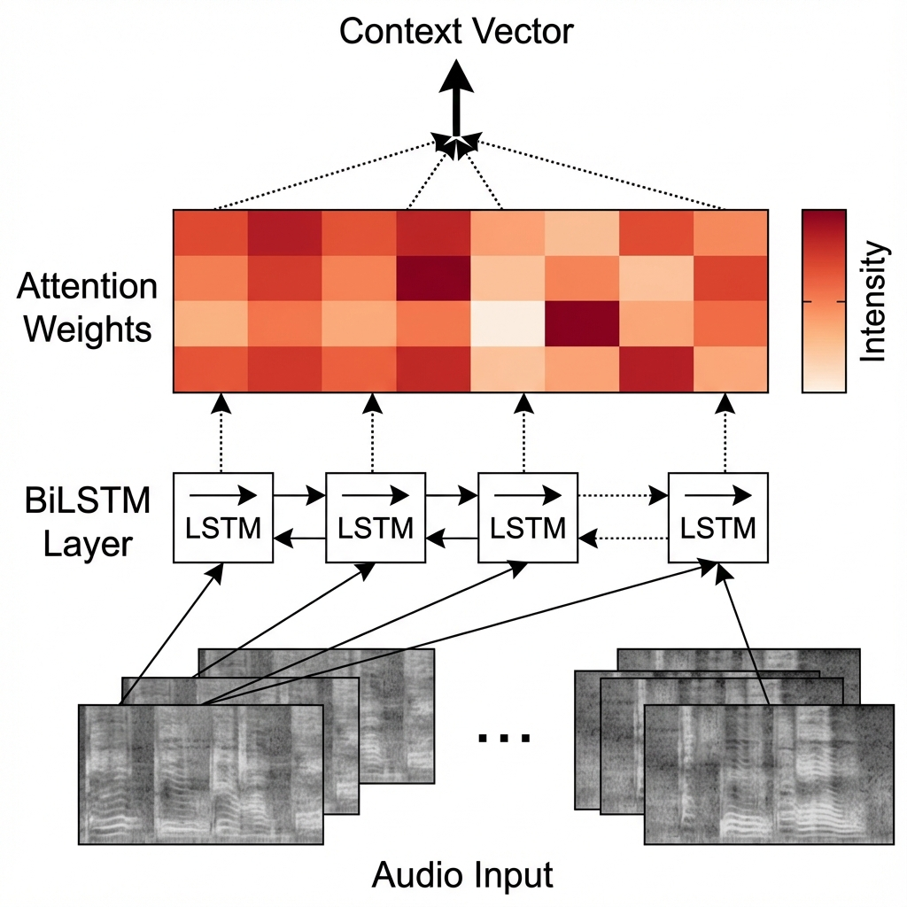
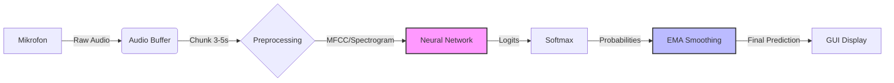
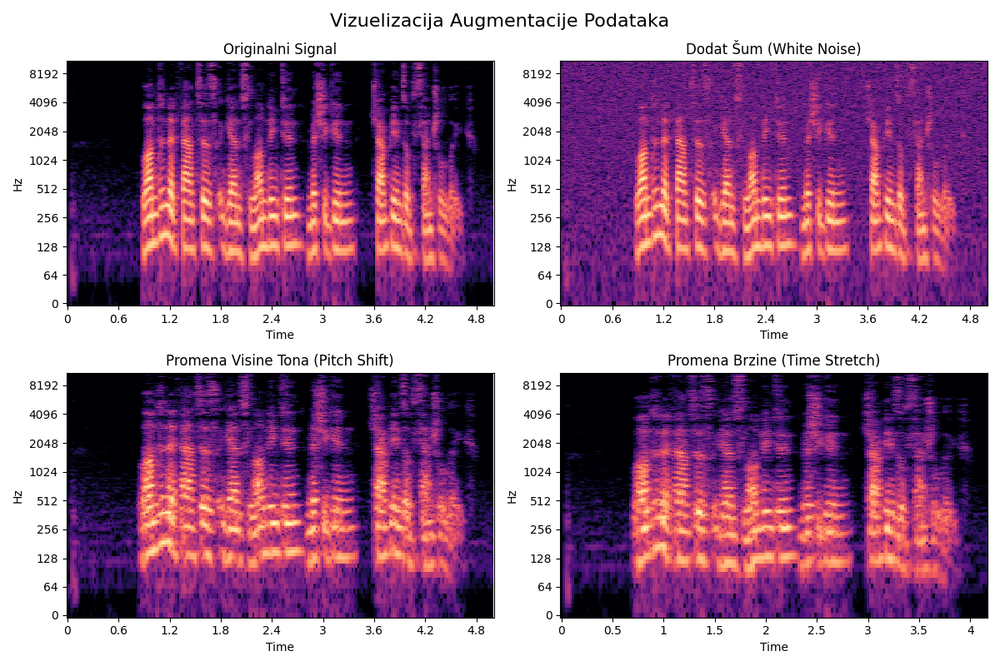
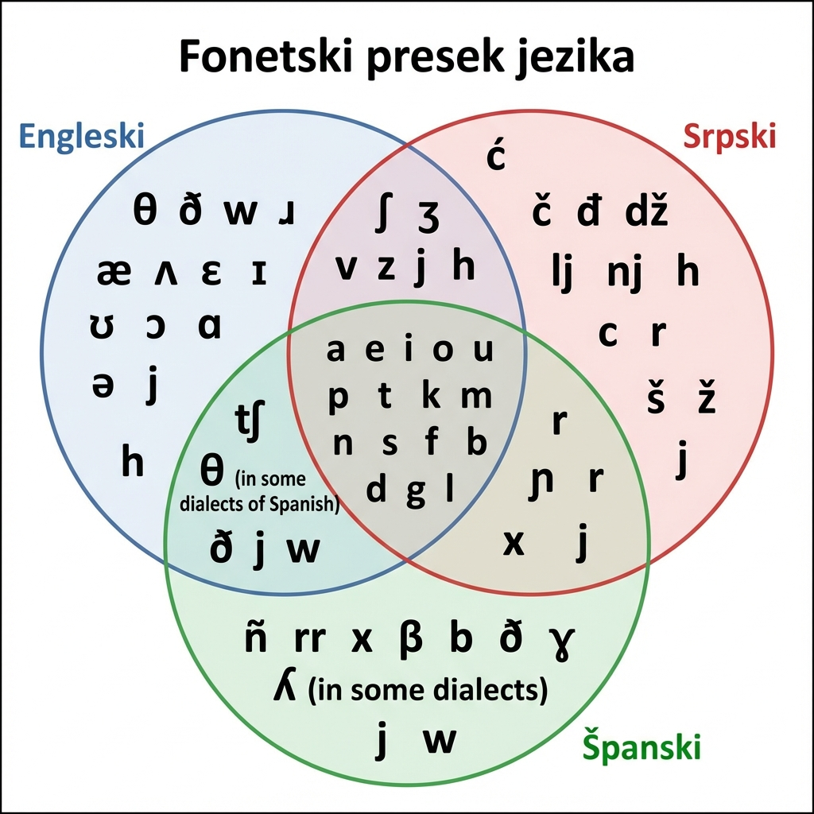

# Prepoznavanje jezika koji se govori

**Studijsko istraživački rad**

---

**Univerzitet u Nišu**  
**Elektronski fakultet**  
**Katedra za računarstvo**

**Mentor:** prof. dr Dragan Janković  
**Student:** Aleksa Milić 1610

**Niš, 2025.**

---

## Apstrakt

Ovaj rad predstavlja implementaciju i evaluaciju sistema za automatsko prepoznavanje jezika iz govornog signala korišćenjem tehnika dubokog učenja [10] i klasičnog mašinskog učenja. Sistem kombinuje savremene metode obrade audio signala kroz različite arhitekture: konvolucione neuronske mreže (CNN) [18], rekurentne neuronske mreže (RNN/LSTM) [1], kao i Wav2Vec model inspirisan dubokim reprezentacijama zvuka [4]. Pored toga, razvijen je hibridni CNN–RNN model i sistem zasnovan na SVM pristupu. Implementirani sistem vrši ekstrakciju MFCC (Mel-Frequency Cepstral Coefficients) i mel-spektrogram karakteristika iz audio zapisa, koje se zatim koriste za treniranje modela.

Eksperimentalni rezultati na datasetu koji sadrži 10.018 test uzoraka pokazuju da Wav2Vec model postiže najbolje performanse, sa tačnošću od 85.06% i F1-score vrednošću od 0.8503. RNN model ostvaruje tačnost od 84.37%, CNN 83.57%, hibridni CNN–RNN 83.46%, dok SVM model dostiže 82.20%. Sistem je implementiran u programskom jeziku Python, uz korišćenje biblioteka TensorFlow i scikit-learn, i omogućava jednostavno korišćenje putem komandne linije.

**Ključne reči:** prepoznavanje jezika, obrada audio signala, duboko učenje, CNN, RNN, LSTM, Wav2Vec, SVM, MFCC, klasifikacija govora.

---

## Sadržaj

1. [Uvod](#1-uvod)
2. [Klasifikacija govornog signala](#2-klasifikacija-govornog-signala)
3. [Metodologija](#3-metodologija)
   - 3.1 [Arhitektura sistema i obrada podataka](#31-arhitektura-sistema-i-obrada-podataka)
   - 3.2 [Arhitekture modela i procedura treniranja](#32-arhitekture-modela-i-procedura-treniranja)
4. [Priprema podataka i treniranje](#4-priprema-podataka-i-treniranje)
5. [Rezultati i analiza](#5-rezultati-i-analiza)
6. [Zaključak](#6-zaključak)
7. [Reference](#7-reference)

---

## Lista skraćenica

| Skraćenica | Puno značenje | Opis |
|------------|---------------|------|
| **SLID** | Spoken Language Identification | Automatsko prepoznavanje govornog jezika |
| **MFCC** | Mel-Frequency Cepstral Coefficients | Karakteristike audio signala bazirane na ljudskoj percepciji |
| **CNN** | Convolutional Neural Network | Konvoluciona neuronska mreža, pogodna za obradu slika i spektrograma |
| **RNN** | Recurrent Neural Network | Rekurentna neuronska mreža, pogodna za sekvencijalne podatke |
| **LSTM** | Long Short-Term Memory | Tip RNN arhitekture koji rešava problem nestajućih gradijenata |
| **SVM** | Support Vector Machine | Algoritam nadgledanog učenja za klasifikaciju |
| **ReLU** | Rectified Linear Unit | Aktivaciona funkcija f(x) = max(0, x) |
| **GMM** | Gaussian Mixture Model | Probabilistički model za klasterizaciju |
| **HMM** | Hidden Markov Model | Statistički model za modelovanje sekvenci |
| **FFT** | Fast Fourier Transform | Algoritam za izračunavanje diskretne Furijeove transformacije |
| **OOM** | Out Of Memory | Greška nedostatka memorije |

---

## 1. Uvod

Razvoj tehnologija za automatsko prepoznavanje jezika iz govornog signala predstavlja jedan od najznačajnijih pravaca istraživanja u oblasti obrade govora i mašinskog učenja. Tokom poslednjih nekoliko decenija, sa ubrzanim procesom globalizacije i eksponencijalnim rastom međunarodne komunikacije, potreba za efikasnim sistemima koji mogu automatski identifikovati jezik govora postala je sve prisutnija u brojnim domenima - od call centara do bezbednosnih aplikacija.

Istorijski gledano, prvi pokušaji automatskog prepoznavanja jezika datiraju iz 1970-ih godina. Tadašnji istraživači koristili su relativno jednostavne akustičke karakteristike i statističke metode za razlikovanje ograničenog broja jezika, uglavnom evropskih. Ovi rani sistemi, zasnovani na analizi spektralnih karakteristika i fonetskih osobina, imali su značajna ograničenja u pogledu tačnosti i skalabilnosti. Tradicionalni pristupi, dominantni do početka 21. veka, oslanjali su se na ručno dizajnirane karakteristike i algoritme poput Gaussian Mixture Models (GMM) i Support Vector Machines (SVM), zahtevajući opsežno ekspertsko znanje iz lingvistike i obrade signala.
    
Prekretnica u ovoj oblasti nastupila je oko 2012. godine sa razvojem dubokih konvolucionih neuronskih mreža i dostupnošću velikih audio skupova podataka. Neuronske mreže su demonstrirale sposobnost automatskog učenja hijerarhijskih reprezentacija iz sirovih audio podataka, eliminišući potrebu za ručnim dizajnom karakteristika. Performanse su značajno nadmašile dotadašnje metode [10], otvarajući put ka sistemima sposobnim da prepoznaju stotine jezika sa visokom preciznošću.

Danas automatsko prepoznavanje jezika ima široku primenu u industriji, društvenim aplikacijama i nauci. U komercijalnom sektoru, tehnologija je ključna za višejezične call centre, gde automatsko rutiranje poziva na osnovu jezika značajno unapređuje efikasnost. Sistemi za prevođenje u realnom vremenu i digitalni asistenti (Alexa, Siri, Google Assistant) oslanjaju se na preciznu identifikaciju jezika kao prvi korak u interakciji sa korisnikom. Streaming platforme takođe koriste ovu tehnologiju za kategorizaciju sadržaja.

U društvenom kontekstu, primena seže od bezbednosnih sistema do alata za pristupačnost koji omogućavaju automatsko titlovanje. Ekonomski značaj je takođe veliki, s obzirom na to da automatizacija ovih procesa smanjuje operativne troškove i omogućava personalizaciju usluga na globalnom tržištu. Sa razvojem IoT uređaja, očekuje se još dublja integracija ove tehnologije u svakodnevni život.

Ipak, treba biti realan - prepoznavanje jezika iz govornog signala i dalje ostaje prilično kompleksan i izazovan zadatak. Za razliku od tekstualnog prepoznavanja jezika (gde je situacija relativno jednostavna jer su karakteristike stabilne i jasno definisane), audio signal nosi sa sobom gomilu izvora varijabilnosti i šuma. Potrebno je prepoznati jezik iz kratkog audio segmenta koji može biti snimljen u različitim akustičkim uslovima, sa različitim kvalitetom opreme, i od govornika sa različitim karakteristikama glasa. Na rezultate značajno utiču faktori kao što su varijabilnost između govornika (pol, starost, individualne karakteristike glasa), kvalitet snimanja (tip mikrofona, pozadinska buka, kompresija audio signala), trajanje audio segmenta (kraći segmenti nose manje informacija), lingvistička sličnost između jezika (posebno unutar istih jezičkih porodica), kao i postojanje dijalekata, regionalnih varijanti i stranih akcenata.

Dodatni izazov predstavlja i fenomen code-switching-a - prebacivanje između jezika tokom govora. Ovo je česta pojava u višejezičnim zajednicama (npr. neko govori srpski ali ubacuje engleske reči). Takođe, govorni signal može sadržati emotivne komponente, različite stilove govora (formalni, neformalni, brzi, spori), pa čak i specifične karakteristike kao što su pevanje, šaputanje ili govor pod stresom. Sve ovo dodatno komplikuje zadatak automatskog prepoznavanja i čini ga zanimljivim istraživačkim problemom.

Zbog svih ovih faktora, razvoj tačnog i robusnog sistema za automatsko prepoznavanje jezika zahteva pažljivo dizajniranu metodologiju, odabir odgovarajućih karakteristika audio signala, primenu naprednih modela mašinskog učenja, kao i opsežno testiranje na raznovrsnim datasetima koji pokrivaju različite scenarije upotrebe. Ovaj rad predstavlja pokušaj da se sistematski istraže različiti pristupi ovom problemu, od klasičnih metoda mašinskog učenja do najsavremenijih arhitektura dubokih neuronskih mreža, sa ciljem da se identifikuju njihove prednosti, ograničenja i optimalne oblasti primene.

---

## 2. Klasifikacija govornog signala

Klasifikacija govornog signala, odnosno Spoken Language IDentification (SLID), predstavlja specifičan podskup problema klasifikacije u mašinskom učenju koji se bavi automatskim prepoznavanjem jezika na osnovu akustičkih karakteristika govora. Za razliku od tekstualne klasifikacije jezika koja analizira pisani sadržaj, SLID sistemi moraju da ekstrahuju relevantne informacije direktno iz audio signala, što uvodi dodatne dimenzije kompleksnosti.

Evolucija pristupa klasifikaciji govornog signala može se podeliti u nekoliko ključnih faza, koje prate razvoj računarske moći i dostupnost podataka.


**Slika 2.1:** Evolucija pristupa u automatskom prepoznavanju jezika - od ranih GMM/HMM modela 1990-ih, preko SVM pristupa 2000-ih, do dominacije dubokog učenja od 2012. godine.

Tokom 1990-ih i ranih 2000-ih, dominirali su GMM (Gaussian Mixture Models) i HMM (Hidden Markov Models) pristupi. Ovi modeli su se oslanjali na ručno dizajnirane karakteristike poput LPC i MFCC koeficijenata, ali su imali ograničenu sposobnost generalizacije na nove govornike i uslove snimanja. Kasniji prelazak na SVM (Support Vector Machines) doneo je poboljšanja u robusnosti, ali je zavisnost od kvaliteta ručno odabranih karakteristika i dalje predstavljala usko grlo. Razvoj dubokog učenja doneo je značajan napredak uvođenjem x-vektora [16] i end-to-end modela.

Revolucija nastaje 2012. godine sa primenom dubokih neuronskih mreža [10]. Konvergencija tri faktora - dostupnost velikih datasetova, razvoj GPU hardvera i napredak u algoritmima optimizacije - omogućila je treniranje dubokih arhitektura, uključujući rezidualne mreže [14] i mehanizme pažnje [15]. Ključna prednost ovog pristupa je end-to-end učenje, gde mreža sama uči optimalne karakteristike direktno iz podataka, često otkrivajući obrasce koje ljudski eksperti ne bi intuitivno uočili.

### CNN arhitekture za SLID

Konvolucione neuronske mreže (CNN), originalno razvijene za kompjutersku viziju, pokazale su se izuzetno efikasnim u obradi audio signala. Osnovni princip primene CNN-a na zvuk leži u tretiranju spektrograma kao dvodimenzionalnih slika, gde horizontalna osa predstavlja vreme, a vertikalna frekvenciju. Intenzitet svake tačke odgovara energiji signala na datoj frekvenciji i u datom trenutku.

Ova analogija omogućava primenu moćnih algoritama za prepoznavanje vizuelnih obrazaca na akustičke podatke. Harmonici se manifestuju kao horizontalne linije, formanti kao specifične spektralne strukture, a tranzicije između fonema kao promene u teksturi slike. Različiti jezici poseduju distinktivne fonetske i prozodijske karakteristike koje se preslikavaju u jedinstvene vizuelne obrasce na spektrogramima.

**Konvolucioni slojevi** su ključni element arhitekture. Oni primenjuju skup naučenih filtera (kernela) na ulazni spektrogram. Svaki filter uči da detektuje specifičan lokalni spektralno-temporalni obrazac. U nižim slojevima, filteri detektuju jednostavne karakteristike poput ivica ili promena energije, dok u višim slojevima kombinuju te informacije za prepoznavanje kompleksnijih struktura kao što su formanti ili specifični jezički obrasci.

Značajna prednost ovog pristupa je automatsko učenje filtera tokom procesa treniranja. Mreža samostalno identifikuje najrelevantnije karakteristike za razlikovanje jezika, često otkrivajući suptilne obrasce koji bi mogli promaknuti u ručnom dizajnu karakteristika.


**Slika 2.2:** Vizualizacija naučenih filtera u prvom konvolucionom sloju CNN modela. Svaki filter detektuje specifične spektralno-temporalne obrasce u mel-spektrogramima. Možemo videti da neki filteri reaguju na horizontalne strukture (harmonici), drugi na vertikalne (brze promene u vremenu), a treći na dijagonalne obrasce (formantne tranzicije).

**Pooling slojevi** (najčešće max pooling ili average pooling) primenjuju se nakon konvolucionih slojeva i imaju nekoliko važnih funkcija. Prvo, oni smanjuju prostornu dimenzionalnost reprezentacije, što redukuje broj parametara u mreži i računsku kompleksnost, čineći model efikasnijim. Drugo, pooling uvodi određeni stepen translacione invarijantnosti - model postaje otporniji na male varijacije u položaju karakteristika u spektrogramu. Ovo je važno jer iste fonetske strukture mogu se pojaviti u različitim vremenskim pozicijama u različitim iskazima, a želimo da model prepozna te strukture nezavisno od njihove tačne pozicije. Tipična veličina pooling prozora je 2×2, što efektivno prepolovi prostorne dimenzije reprezentacije.

**Aktivacione funkcije** uvode nelinearnost u model, što je ključno za sposobnost mreže da modeluje kompleksne, nelinearne odnose između ulaza i izlaza. Najčešće korišćena aktivaciona funkcija u modernim CNN arhitekturama je ReLU (Rectified Linear Unit), definisana kao f(x) = max(0, x). ReLU ima nekoliko prednosti: jednostavna je za računanje, ne pati od problema vanishing gradient-a koji muči neke druge aktivacione funkcije (kao što je sigmoid), i empirijski se pokazalo da ubrzava konvergenciju tokom treniranja [14]. Varijante ReLU funkcije, kao što su Leaky ReLU ili Parametric ReLU, ponekad se koriste da bi se izbegao problem "umirućih" neurona koji mogu nastati sa standardnom ReLU funkcijom.

**Batch normalizacija** je tehnika koja se često uključuje između konvolucionih slojeva i aktivacionih funkcija. Ona normalizuje aktivacije svakog sloja tako da imaju srednju vrednost blizu nule i standardnu devijaciju blizu jedan, što stabilizuje proces treniranja i omogućava korišćenje većih learning rate-ova. Batch normalizacija takođe ima blagi regularizacioni efekat, smanjujući potrebu za drugim tehnikama regularizacije.

**Fully connected (dense) slojevi** dolaze na kraju CNN arhitekture i agregiraju sve naučene karakteristike iz konvolucionih slojeva da bi izvršili finalnu klasifikaciju. Pre fully connected slojeva, višedimenzionalni tensor koji izlazi iz poslednjeg konvolucionog/pooling sloja se "spljoštava" (flatten) u jednodimenzionalni vektor. Ovaj vektor zatim prolazi kroz jedan ili više fully connected slojeva, pri čemu poslednji sloj ima broj neurona jednak broju klasa (jezika) koje želimo da prepoznamo. Softmax aktivaciona funkcija primenjuje se na izlaz poslednjeg sloja da bi se dobila distribucija verovatnoća preko svih klasa, pri čemu zbir svih verovatnoća iznosi 1.

Tipična CNN arhitektura za SLID može imati 4–6 konvolucionih blokova, gde svaki blok sastoji se od konvolucionog sloja, batch normalizacije, aktivacione funkcije i pooling sloja. Broj filtera obično se postepeno povećava kroz slojeve (npr. 32→64→128→256), što omogućava mreži da uči sve kompleksnije reprezentacije. Dropout slojevi (sa stopom isključivanja između 0.3 i 0.5) često se dodaju između fully connected slojeva kao tehnika regularizacije koja sprečava overfitting tako što nasumično isključuje određeni procenat neurona tokom treniranja [18].

Jedna od ključnih prednosti CNN arhitektura za SLID jeste njihova sposobnost da automatski uče hijerarhijske reprezentacije. Niži slojevi uče jednostavne, lokalne karakteristike, dok viši slojevi kombinuju te karakteristike da formiraju kompleksnije, apstraktnije reprezentacije koje su direktno relevantne za zadatak klasifikacije jezika. Ova hijerarhijska priroda učenja omogućava CNN-ovima da postignu visoku tačnost čak i na izazovnim datasetima sa velikim brojem jezika.

### RNN/LSTM arhitekture

Rekurentne neuronske mreže (RNN) predstavljaju fundamentalno drugačiji pristup obradi audio signala u odnosu na CNN arhitekture. Dok CNN-ovi tretiraju spektrograme kao statične slike, RNN-ovi su specijalizovani za obradu sekvencijalnih podataka gde postoji inherentna temporalna zavisnost između uzastopnih elemenata. Ova karakteristika čini ih prirodnim izborom za analizu govornog signala, koji je po svojoj prirodi sekvencijalan - ono što se govori u jednom trenutku zavisi od onoga što je rečeno pre toga i utiče na ono što će biti rečeno posle.

Osnovna ideja RNN arhitekture jeste održavanje "memorije" kroz skriveno stanje koje se ažurira sa svakim novim ulaznim elementom u sekvenci. Za razliku od feedforward neuronskih mreža gde informacija teče samo u jednom smeru (od ulaza ka izlazu), RNN-ovi imaju rekurentne veze koje omogućavaju informaciji da kruži kroz mrežu. Ovo znači da izlaz mreže u trenutku t zavisi ne samo od ulaza u tom trenutku, već i od svih prethodnih ulaza kroz akumulirano skriveno stanje.

Matematički, standardni RNN se može opisati jednačinama ažuriranja skrivenog stanja i izlaza. Međutim, standardni RNN modeli pate od problema nestajućih ili eksplodirajućih gradijenata (vanishing/exploding gradients). Tokom propagacije unazad kroz vreme (BPTT), gradijenti mogu postati ekstremno mali ili veliki, što onemogućava mrežu da uči dugoročne zavisnosti. Ovo je kritično ograničenje za obradu govora, gde relevantne informacije mogu biti vremenski udaljene.

**LSTM (Long Short-Term Memory) arhitektura** [9] rešava ovaj problem uvođenjem memorijske ćelije i mehanizma "kapija" (gates). Ovi mehanizmi precizno kontrolišu tok informacija - šta se pamti, šta se zaboravlja i šta se prosleđuje dalje. LSTM jedinica sadrži tri ključne kapije:

LSTM jedinica sastoji se od tri ključna gate mehanizma:

**Forget gate** (gate zaboravljanja) odlučuje koje informacije iz prethodnog stanja memorijske ćelije treba odbaciti. On gleda na prethodno skriveno stanje h<sub>t-1</sub> i trenutni ulaz x<sub>t</sub>, i za svaku vrednost u memorijskoj ćeliji C<sub>t-1</sub> proizvodi broj između 0 i 1, gde 0 znači "potpuno zaboravi ovo" a 1 znači "potpuno zadrži ovo":

f<sub>t</sub> = σ(W<sub>f</sub> · [h<sub>t-1</sub>, x<sub>t</sub>] + b<sub>f</sub>)

**Input gate** (ulazni gate) odlučuje koje nove informacije treba dodati u memorijsku ćeliju. Ovo se dešava u dva koraka: prvo, sigmoid sloj (input gate) odlučuje koje vrednosti treba ažurirati, a zatim tanh sloj kreira vektor kandidata novih vrednosti C̃<sub>t</sub> koje bi mogle biti dodate u stanje:

i<sub>t</sub> = σ(W<sub>i</sub> · [h<sub>t-1</sub>, x<sub>t</sub>] + b<sub>i</sub>)

C̃<sub>t</sub> = tanh(W<sub>C</sub> · [h<sub>t-1</sub>, x<sub>t</sub>] + b<sub>C</sub>)

**Output gate** (izlazni gate) odlučuje koji deo memorijske ćelije će biti izlaz trenutnog koraka. Prvo se primenjuje sigmoid sloj koji odlučuje koje delove stanja ćelije ćemo izlaziti, a zatim se stanje ćelije propušta kroz tanh (da bi se vrednosti normalizovale između -1 i 1) i množi sa izlazom sigmoid gate-a:

o<sub>t</sub> = σ(W<sub>o</sub> · [h<sub>t-1</sub>, x<sub>t</sub>] + b<sub>o</sub>)

Konačno stanje ćelije i skriveno stanje se ažuriraju na sledeći način:

C<sub>t</sub> = f<sub>t</sub> ⊙ C<sub>t-1</sub> + i<sub>t</sub> ⊙ C̃<sub>t</sub>

h<sub>t</sub> = o<sub>t</sub> ⊙ tanh(C<sub>t</sub>)

gde ⊙ označava element-wise množenje (Hadamard proizvod).

Ova arhitektura omogućava LSTM-u da selektivno zapamti ili zaboravi informacije, što mu daje sposobnost da uči dugoročne zavisnosti u sekvencama. U kontekstu prepoznavanja jezika, ovo je posebno važno jer različiti jezici imaju različite temporalne strukture - neki jezici imaju brz ritam sa kratkim slogovima, dok drugi imaju sporiji ritam sa dugim rečima; neki jezici su tonski i zahtevaju praćenje promene visine tona kroz vreme; neki imaju kompleksne prozodijske obrasce koji se manifestuju kroz duže segmente govora.

LSTM mreže su se pokazale posebno efikasnim kod jezika sa promenljivim ritmom, dugačkim rečima i složenom prozodijskom strukturom [1, 2]. Na primer, aglutinativni jezici kao što su finski ili turski, gde se reči formiraju dodavanjem mnogih sufiksa, zahtevaju sposobnost praćenja informacija kroz relativno duge vremenske periode. Slično, tonski jezici kao što su mandarinski ili vijetnamski zahtevaju precizno modelovanje promena visine tona kroz vreme.

**Bidirectional LSTM (BiLSTM)** arhitektura dodatno poboljšava performanse obrađujući sekvencu u oba smera - i napred i nazad kroz vreme. Ideja je da za razumevanje određenog dela sekvence često pomažu informacije ne samo iz prošlosti već i iz budućnosti. U kontekstu prepoznavanja jezika, poznavanje onoga što dolazi posle određenog segmenta govora može pomoći u boljoj interpretaciji tog segmenta. BiLSTM se sastoji od dve odvojene LSTM mreže - jedna obrađuje sekvencu od početka ka kraju, a druga od kraja ka početku. Izlazi ove dve mreže se zatim kombinuju (obično konkatenacijom) da formiraju finalnu reprezentaciju koja sadrži kontekst iz oba smera.

Praktična primena LSTM arhitektura za SLID obično uključuje stekovanje više LSTM slojeva (tipično 2-4 sloja), gde svaki sloj uči sve apstraktnije reprezentacije sekvence. Dropout regularizacija se često primenjuje između slojeva da bi se sprečio overfitting. Za zadatak klasifikacije jezika, obično se koristi izlaz poslednjeg vremenskog koraka ili se primenjuje neka forma pooling-a (npr. average ili max pooling) preko svih vremenskih koraka da bi se dobila fiksna reprezentacija cele sekvence, koja se zatim propušta kroz fully connected slojeve za finalnu klasifikaciju.

---

### MFCC (Mel-Frequency Cepstral Coefficients)

Mel-Frequency Cepstral Coefficients (MFCC) predstavljaju jednu od najšire korišćenih reprezentacija audio signala u zadacima obrade govora. Razvijeni tokom 1980-ih godina, MFCC koeficijenti su dizajnirani da imitiraju način na koji ljudski auditorni sistem percipira zvuk, što ih čini posebno pogodnim za aplikacije koje uključuju govorni signal. Osnovna ideja je da ljudsko uho ne percipira frekvencije na linearnoj skali - mi smo mnogo osetljiviji na razlike između niskih frekvencija nego između visokih frekvencija. Na primer, razlika između 100 Hz i 200 Hz je perceptualno mnogo značajnija od razlike između 10,100 Hz i 10,200 Hz, iako je apsolutna razlika ista.

Proces ekstrakcije MFCC koeficijenata sastoji se od nekoliko pažljivo dizajniranih koraka, od kojih svaki ima specifičnu ulogu u transformaciji sirovog audio signala u kompaktnu reprezentaciju pogodnu za mašinsko učenje:


**Slika 2.4:** Dijagram toka ekstrakcije MFCC koeficijenata. Proces počinje sa sirovim audio signalom i prolazi kroz sedam koraka: pre-emphasis filtering, framing, windowing, FFT, mel-filter bank, logaritamsku kompresiju, i konačno DCT koji proizvodi finalne MFCC koeficijente. Svaki korak ima specifičnu ulogu u transformaciji signala.

**1. Pre-emphasis filtering** je prvi korak u obradi signala. Ovaj korak primenjuje visokopropusni filter na signal, tipično u formi y[n] = x[n] - α·x[n-1], gde je α koeficijent koji se obično postavlja na vrednost oko 0.97. Svrha ovog koraka je da pojača više frekvencije u signalu koje su prirodno slabije u govornom signalu zbog fizike produkcije govora. Tokom govora, vazduh prolazi kroz vokalni trakt i vibracije glasnih žica, što prirodno rezultira u spektru koji opada sa frekvencijom. Pre-emphasis kompenzuje ovaj pad i balansira spektar, što olakšava dalju analizu i poboljšava performanse sistema.

**2. Framing** je proces segmentacije kontinualnog audio signala u kratke, preklapajuće okvire (frame-ove). Tipična dužina okvira je između 20 i 40 milisekundi, što odgovara periodu tokom kojeg se karakteristike govornog signala mogu smatrati relativno stabilnim (kvazi-stacionarnim). Okviri se obično preklapaju za 50%, što znači da ako je okvir dužine 25ms, sledeći okvir počinje nakon 12.5ms (hop length). Ovo preklapanje osigurava da ne propustimo važne informacije koje bi mogle biti na granicama okvira i omogućava glatkiji prelaz između uzastopnih analiza.

**3. Windowing** se primenjuje na svaki okvir da bi se smanjio efekat spektralnog curenja (spectral leakage) koji nastaje zbog činjenice da okvir ima konačnu dužinu. Kada primenjujemo Fourier transformaciju na okvir, implicitno pretpostavljamo da je signal periodičan, što obično nije slučaj. Ovo može dovesti do artificijalnih frekvencijskih komponenti u spektru. Primena prozorske funkcije (najčešće Hamming ili Hann prozor) postepeno smanjuje amplitudu signala ka ivicama okvira, čime se minimizuje diskontinuitet na granicama i redukuje spektralno curenje. Hamming prozor je definisan kao w[n] = 0.54 - 0.46·cos(2πn/(N-1)), gde je N dužina prozora.

**4. Fast Fourier Transform (FFT)** transformiše svaki prozorski okvir iz vremenskog domena u frekvencijski domen. FFT je efikasan algoritam za računanje Diskretne Fourier Transformacije (DFT) i omogućava nam da vidimo koje frekvencije su prisutne u signalu i sa kojim intenzitetom. Tipično se koristi FFT sa 512 ili 1024 tačaka, što daje dovoljnu frekventnu rezoluciju za analizu govornog signala. Rezultat FFT-a je kompleksni spektar, ali nas obično interesuje samo magnituda (power spectrum), koja se dobija kao kvadrat apsolutne vrednosti kompleksnih koeficijenata.

**5. Mel-filter bank** primenjuje skup trougaonih filtera na power spektar dobijen iz FFT-a. Ovi filteri su raspoređeni na mel-skali, koja je nelinearna skala frekvencija dizajnirana da aproksimira način na koji ljudsko uho percipira visinu tona. Konverzija između linearne frekvencijske skale (u Hz) i mel-skale data je formulom: m = 2595 · log₁₀(1 + f/700), gde je f frekvencija u Hz, a m frekvencija u melovima. Na niskim frekvencijama, filteri su usko raspoređeni (veća frekventna rezolucija), dok su na visokim frekvencijama raspoređeni šire (manja rezolucija), što odražava smanjenu osetljivost ljudskog uha na razlike između visokih frekvencija. Tipično se koristi između 20 i 40 mel filtera, što rezultira u istom broju mel-frekventnih koeficijenata.

**6. Logaritamska kompresija** primenjuje se na izlaz mel-filter bank-a. Uzimanje logaritma energije (S = log(E)) ima dve važne funkcije: prvo, simulira način na koji ljudsko uho percipira intenzitet zvuka (mi percipiramo intenzitet približno logaritamski, što je poznato kao Weber-Fechner zakon), i drugo, kompresuje dinamički opseg vrednosti, što pomaže u numeričkoj stabilnosti i olakšava učenje modela. Logaritamska kompresija takođe ima efekat pretvaranja multiplikativnih odnosa u aditivne, što može biti korisno za modelovanje određenih karakteristika govora.

**7. Discrete Cosine Transform (DCT)** je finalni korak koji primenjuje kosinusnu transformaciju na logaritamske mel-frekventne koeficijente. DCT je slična Fourier transformaciji ali radi samo sa realnim brojevima i ima svojstvo da kompaktuje energiju u nekoliko prvih koeficijenata. Tipično se zadržava prvih 12-20 MFCC koeficijenata (od ukupno 20-40 koliko ih DCT proizvodi), jer oni sadrže većinu relevantnih informacija. Viši koeficijenti obično predstavljaju brze varijacije u spektru koje često odgovaraju šumu ili manje relevantnim detaljima.

Dodatno, često se računaju i **delta i delta-delta koeficijenti** (prvi i drugi izvodi MFCC-a po vremenu), koji hvataju dinamiku promena u govornom signalu. Delta koeficijenti pokazuju kako se MFCC menjaju između uzastopnih okvira, dok delta-delta koeficijenti pokazuju akceleraciju tih promena. Ove temporalne karakteristike su važne jer različiti jezici imaju različite dinamičke karakteristike - na primer, brzinu artikulacije, način prelaza između fonema, ili prozodijske obrasce.

Finalna MFCC reprezentacija jednog audio segmenta je tipično matrica dimenzija (broj_okvira × broj_koeficijenata), gde broj_okvira zavisi od dužine audio segmenta i hop length-a, a broj_koeficijenata je obično između 13 i 40 (uključujući delta i delta-delta koeficijente ako se koriste). Ova kompaktna reprezentacija zadržava ključne informacije o spektralnom sadržaju signala na način koji je prilagođen ljudskoj percepciji, što je čini izuzetno efikasnom za zadatke prepoznavanja govora i jezika [11].

### Mel-spektrogram

Mel-spektrogram predstavlja 2D vremensko-frekventnu reprezentaciju signala na mel-skali. Za razliku od MFCC koji daje komprimovane koeficijente, mel-spektrogram zadržava punu spektralnu informaciju i vizualno je pogodan za CNN. Tipične dimenzije su 128 mel filtera × vremenski okviri, sa amplitudama konvertovanim u decibele za bolji dinamički opseg. Na slici 1 prikazan je primer mel-spektrograma govornog signala sa 128 mel filtera, gde se jasno uočavaju harmonici i formanti.


**Slika 1:** Mel-spektrogram govornog signala (128 mel filtera) prikazuje vremensko-frekventnu energetsku distribuciju. Jasno vidljivi harmonici i formanti omogućavaju CNN modelima da automatski uče diskriminativne karakteristike različitih jezika.


**Slika 2.3:** Poređenje mel-spektrograma iste rečenice izgovorene na pet različitih jezika. Možemo uočiti razlike u prozodijskim obrascima (intonacija), spektralnoj strukturi (fonetski inventar), i temporalnoj dinamici (ritam govora). Engleski pokazuje karakterističan obrazac sa jasno definisanim formantima, srpski ima specifične visokofrekventne komponente zbog glasova kao što su ć i č, nemački pokazuje oštre tranzicije između fonema, dok španski i francuski dele određene sličnosti u spektralnoj strukturi što objašnjava zašto se ova dva jezika ponekad mešaju u klasifikaciji.

### Dodatne spektralne karakteristike

Pored MFCC koeficijenata i mel-spektrograma, postoji čitav niz dodatnih spektralnih karakteristika koje mogu pružiti komplementarne informacije o audio signalu i potencijalno poboljšati performanse sistema za prepoznavanje jezika. Ove karakteristike često hvataju različite aspekte audio signala koji možda nisu optimalno reprezentovani kroz MFCC.

**Spectral Centroid** predstavlja "centar mase" spektra i može se shvatiti kao mera prosečne frekvencije u signalu, ponderisane intenzitetom svake frekvencijske komponente. Matematički se definiše kao:

SC = Σ(f<sub>k</sub> · M<sub>k</sub>) / Σ(M<sub>k</sub>)

gde je f<sub>k</sub> frekvencija, a M<sub>k</sub> magnituda u frekvencijskom bin-u k. Perceptualno, spectral centroid odgovara "svetlini" ili "brilijantnosti" zvuka - viši centroid odgovara "svetlijem" zvuku sa više visokih frekvencija, dok niži centroid odgovara "tamnijim", basovitijim zvucima. U kontekstu prepoznavanja jezika, različiti jezici mogu imati različite prosečne spektralne centroide zbog razlika u fonetskom inventaru - na primer, jezici sa više frikatnih glasova (kao što su s, š, f) mogu imati viši prosečni centroid.

**Spectral Rolloff** definiše se kao frekvencija ispod koje je koncentrisano određeni procenat (tipično 85% ili 95%) ukupne spektralne energije. Ova karakteristika je indikator zastupljenosti visokih frekvencija u signalu - niži rolloff ukazuje na signal sa dominantno niskim frekvencijama, dok viši rolloff ukazuje na prisustvo značajne energije u visokim frekvencijama. Spectral rolloff može biti koristan za razlikovanje između različitih tipova fonema (na primer, vokali obično imaju niži rolloff od frikatnih konsonanata) i može pomoći u identifikaciji jezika koji imaju različite distribucije fonetskih kategorija.

**Zero Crossing Rate (ZCR)** meri koliko često signal menja znak (prelazi kroz nulu) u okviru jednog okvira. Matematički, ZCR se može definisati kao:

ZCR = (1/2N) · Σ|sgn(x[n]) - sgn(x[n-1])|

gde je sgn() funkcija znaka, a N broj uzoraka u okviru. ZCR je posebno koristan za razlikovanje između tonskih (voiced) i šumnih (unvoiced) segmenata govora. Tonski segmenti (kao što su vokali) imaju relativno nizak ZCR jer su dominantno periodični sa niskim frekvencijama, dok šumni segmenti (kao što su frikativi) imaju visok ZCR zbog prisustva visokih frekvencija i šumne prirode. Različiti jezici imaju različite proporcije tonskih i šumnih segmenata, što ZCR može pomoći da uhvati.

**Spectral Flux** meri brzinu promene spektra kroz vreme i definiše se kao razlika između spektara uzastopnih okvira:

SF<sub>t</sub> = Σ(|M<sub>t</sub>[k] - M<sub>t-1</sub>[k]|)

gde je M<sub>t</sub>[k] magnituda frekvencijskog bin-a k u okviru t. Visok spectral flux ukazuje na brze promene u spektralnom sadržaju, što može odgovarati prelazima između fonema, brzoj artikulaciji, ili dinamičkim prozodijskim karakteristikama. Jezici sa bržim tempom govora ili češćim fonetskim prelazima mogu imati viši prosečni spectral flux.

**Chroma features** (ili Pitch Class Profiles) predstavljaju energiju distribuiranu preko 12 muzičkih tonova (C, C#, D, D#, E, F, F#, G, G#, A, A#, B), nezavisno od oktave. Iako su originalno razvijene za analizu muzike, chroma features mogu biti korisne i za analizu govora, posebno za jezike sa izraženom tonskom komponentom ili specifičnim intonacionim obrascima. Chroma features mogu pomoći u hvatanju prozodijskih karakteristika koje razlikuju jezike - na primer, tonski jezici kao što su mandarinski ili vijetnamski imaju leksički značajne promene visine tona koje se mogu reflektovati u chroma reprezentaciji.

**Spectral Contrast** meri razliku između vrhova i dolina u spektru, pružajući informacije o spektralnoj strukturi signala. Za razliku od spectral centroid-a koji daje jednu globalnu meru, spectral contrast analizira spektar u više frekvencijskih opsega i za svaki opseg računa razliku između prosečne energije u vrhovima i dolinima. Ova karakteristika može biti korisna za razlikovanje između različitih tipova zvukova i fonetskih kategorija.

**Spectral Bandwidth** meri "širinu" spektra oko spectral centroid-a i može se shvatiti kao mera spektralne disperzije. Uži bandwidth ukazuje na signal sa energijom koncentrisanom oko određenih frekvencija (kao što su čisti tonovi ili vokali), dok širi bandwidth ukazuje na signal sa energijom raspoređenom preko šireg frekvencijskog opsega (kao što su šumni konsonanti).

**Formanti** su rezonantne frekvencije vokalnog trakta i predstavljaju jedne od najvažnijih karakteristika za razlikovanje vokala. Različiti vokali karakterišu se različitim pozicijama prvih nekoliko formanata (tipično F1, F2, i F3). Iako ekstrakcija formanata može biti izazovna i podložna greškama, oni nose direktne informacije o artikulaciji i mogu biti veoma diskriminativni za prepoznavanje jezika, posebno jer različiti jezici imaju različite vokalske sisteme.

U praksi, izbor karakteristika zavisi od specifične aplikacije i dostupnih resursa. MFCC koeficijenti ostaju najčešće korišćena reprezentacija zbog svoje kompaktnosti, robusnosti i dokazane efikasnosti. Mel-spektrogrami su postali popularniji sa razvojem dubokih konvolucionih mreža koje mogu automatski da uče relevantne karakteristike iz ove bogatije reprezentacije. Kombinacija različitih karakteristika može pružiti komplementarne informacije i poboljšati performanse, ali takođe povećava dimenzionalnost podataka i računsku kompleksnost.

Važno je napomenuti da savremeni pristupi zasnovani na dubokom učenju često uče karakteristike direktno iz sirovih podataka ili iz relativno jednostavnih reprezentacija kao što su mel-spektrogrami, eliminirajući potrebu za ručnim dizajnom kompleksnih karakteristika. Međutim, razumevanje ovih tradicionalnih karakteristika i dalje je važno jer pruža uvid u to koje informacije su relevantne za zadatak i može voditi dizajnu boljih arhitektura neuronskih mreža.

Kombinacija ovih karakteristika, naročito MFCC i mel-spektrograma, čini osnovu većine modernih SLID sistema, omogućavajući balans između kompresije informacija i zadržavanja relevantnih detalja [3, 18]. Izbor između različitih reprezentacija često zavisi od trade-off-a između informativnosti, računske efikasnosti, i kompatibilnosti sa izabranom arhitekturom modela.

---

## 3. Metodologija

Metodologija ovog istraživanja obuhvata sistematski pristup razvoju i evaluaciji sistema za automatsko prepoznavanje jezika. Proces je podeljen u nekoliko ključnih faza: dizajn arhitekture sistema, pripremu i obradu podataka, implementaciju različitih modela mašinskog učenja, treniranje i optimizaciju hiperparametara, te konačno evaluaciju i analizu performansi. Svaka od ovih faza zahteva pažljivo razmatranje brojnih faktora kako bi se osiguralo da finalni sistem bude robustan, tačan i praktično upotrebljiv.

Prilikom dizajniranja metodologije, vodilo se računa o nekoliko ključnih principa. Prvo, sistem mora biti modularan - svaka komponenta treba da bude nezavisna i zamenljiva, što omogućava lako testiranje različitih pristupa i konfiguracija. Drugo, potrebno je osigurati reproducibilnost rezultata kroz fiksiranje random seed-ova i detaljno dokumentovanje svih parametara. Treće, evaluacija mora biti fer i konzistentna - svi modeli se testiraju na identičnim podacima pod istim uslovima. Konačno, sistem treba da bude skalabilan i lako proširiv na nove jezike ili različite uslove upotrebe.

### 3.1 Arhitektura sistema i obrada podataka

Implementirani sistem za prepoznavanje jezika sastoji se od nekoliko modularnih komponenti koje zajedno formiraju kompletan pipeline od sirovog audio signala do predikcije jezika. Dizajn sistema zasniva se na principima softverskog inženjerstva koji naglašavaju modularnost, ponovnu upotrebljivost koda, i jasnu separaciju odgovornosti između komponenti. Ovakav pristup ne samo da olakšava razvoj i održavanje sistema, već takođe omogućava jednostavno eksperimentisanje sa različitim konfiguracijama i pristupima.

Sistem se sastoji od sledećih glavnih komponenti:

- **Audio Processor:** Učitavanje i priprema audio zapisa
- **Feature Extractor:** Ekstrakcija MFCC i spektrogram karakteristika
- **Dataset Builder:** Priprema dataseta za treniranje
- **Modeli:** Pet različitih pristupa klasifikaciji
  - **Wav2Vec Model:** Transformer-inspirisan model sa bidirekcionalnim LSTM
  - **RNN Model:** Rekurentna neuronska mreža sa LSTM jedinicama
  - **CNN Model:** Konvoluciona neuronska mreža za obradu spektrograma
  - **Hybrid CNN-RNN:** Kombinovani pristup sa CNN i RNN slojevima
  - **SVM Model:** Klasični mašinsko učenje pristup kao baseline
- **Evaluator:** Evaluacija performansi i vizualizacija rezultata
- **Language Recognizer:** Interfejs za prepoznavanje jezika iz novih audio zapisa

#### Audio Processing

Audio Processing modul predstavlja prvu fazu u pipeline-u obrade i odgovoran je za učitavanje, validaciju i normalizaciju audio zapisa. Ova komponenta je kritična jer kvalitet ulaznih podataka direktno utiče na performanse celog sistema - princip "garbage in, garbage out" posebno je relevantan u mašinskom učenju. Modul je implementiran u Python-u korišćenjem librosa biblioteke [5], koja pruža robusne i efikasne funkcije za manipulaciju audio signalima.

Tokom razvoja ovog modula, suočili smo se sa nekoliko praktičnih izazova. Prvo, audio zapisi iz različitih izvora mogu imati različite sample rate-ove, broj kanala (mono ili stereo), i formate (WAV, MP3, FLAC, itd.). Drugo, neki zapisi mogu biti oštećeni ili imati neočekivane karakteristike koje mogu uzrokovati greške tokom obrade. Treće, potrebno je balansirati između očuvanja kvaliteta signala i računske efikasnosti - na primer, viši sample rate pruža bolju frekventnu rezoluciju ali zahteva više memorije i procesorske moći.

Ključne funkcionalnosti modula:

```python
class AudioProcessor:
    def __init__(self, target_sr=16000):
        self.target_sr = target_sr
    
    def load_audio(self, file_path):
        # Učitavanje audio fajla
        signal, sr = librosa.load(file_path, sr=None)
        return signal, sr
    
    def preprocess(self, signal, sr):
        # Konverzija u mono
        if signal.ndim > 1:
            signal = librosa.to_mono(signal)
        
        # Resampling na 16kHz
        if sr != self.target_sr:
            signal = librosa.resample(signal, orig_sr=sr, 
                                     target_sr=self.target_sr)
        return signal
```

Normalizacija parametara:

- **Sample rate:** 16 kHz (standardna vrednost za govorni signal) - Ova vrednost je izabrana jer predstavlja dobar kompromis između kvaliteta i efikasnosti. Nyquist-Shannon teorema kaže da sample rate mora biti najmanje dvostruko veći od najviše frekvencije koju želimo da uhvatimo. Pošto je ljudski govor dominantno koncentrisan ispod 8 kHz, 16 kHz sample rate je dovoljan da uhvati sve relevantne informacije. Viši sample rate-ovi (npr. 44.1 kHz ili 48 kHz) bi doneli marginalne koristi uz značajno povećanje računske kompleksnosti.

- **Broj kanala:** Mono (konverzija stereo zapisa) - Stereo zapisi se konvertuju u mono jer prostorna informacija (razlika između levog i desnog kanala) nije relevantna za identifikaciju jezika. Konverzija se vrši prosečavanjem oba kanala, što očuvava sve frekventne komponente dok redukuje količinu podataka za obradu.

- **Format:** Podrška za WAV, MP3 i FLAC formate - WAV je nekompresovani format koji pruža najbolji kvalitet ali zauzima najviše prostora. MP3 je kompresovani format sa gubitkom koji je široko rasprostranjen ali može uvesti artifakte. FLAC je kompresovani format bez gubitka koji pruža dobar balans. Librosa biblioteka [5] automatski dekodira sve ove formate u uniformnu reprezentaciju.

Dodatno, modul implementira nekoliko mehanizama za rukovanje greškama i edge case-ovima. Na primer, ako je audio fajl previše kratak (manje od 1 sekunde), sistem ga odbacuje jer ne sadrži dovoljno informacija za pouzdanu klasifikaciju. Ako je fajl oštećen ili u nepoznatom formatu, sistem beleži grešku i nastavlja sa sledećim fajlom umesto da prekine ceo proces. Takođe, implementirana je normalizacija amplitude signala kako bi se osiguralo da svi zapisi imaju sličan nivo glasnoće, što sprečava da razlike u nivou snimanja utiču na ekstrakciju karakteristika.

---

#### Feature Extraction

Feature Extraction modul predstavlja ključnu komponentu sistema koja transformiše sirovi audio signal u numeričke reprezentacije pogodne za mašinsko učenje. Kvalitet ekstraktovanih karakteristika direktno determiniše gornju granicu performansi koje model može postići - čak i najsofisticiraniji model ne može naučiti diskriminativne obrasce ako karakteristike ne sadrže relevantne informacije. Ovaj modul implementira dve komplementarne reprezentacije: MFCC koeficijente za RNN modele i mel-spektrograme za CNN modele.

Izbor između različitih reprezentacija nije proizvoljan već se zasniva na prirodi arhitekture modela i tipu informacija koje želimo da uhvatimo. MFCC koeficijenti su kompaktna reprezentacija koja agregira spektralne informacije u mali broj koeficijenata, što ih čini pogodnim za sekvencionalne modele koji mogu efikasno procesirati duže sekvence. Mel-spektrogrami, s druge strane, zadržavaju punu vremensko-frekventnu strukturu signala, što omogućava CNN modelima da automatski uče relevantne prostorne obrasce.

**MFCC Ekstrakcija:**

```python
class FeatureExtractor:
    def __init__(self, n_mfcc=40, n_fft=2048, hop_length=512):
        self.n_mfcc = n_mfcc
        self.n_fft = n_fft
        self.hop_length = hop_length
    
    def extract_mfcc(self, signal, sr):
        mfcc = librosa.feature.mfcc(
            y=signal,
            sr=sr,
            n_mfcc=self.n_mfcc,
            n_fft=self.n_fft,
            hop_length=self.hop_length
        )
        return mfcc
```

Parametri ekstrakcije su pažljivo odabrani na osnovu literature i preliminarnih eksperimenata:

- **n_mfcc:** 40 koeficijenata - Ovo je više od standardnih 13 koeficijenata koji se često koriste u prepoznavanju govora, ali smo empirijski utvrdili da dodatni koeficijenti nose korisne informacije za razlikovanje jezika. Prvih 12-13 koeficijenata hvataju opštu spektralnu strukturu, dok viši koeficijenti hvataju finije detalje koji mogu biti diskriminativni između sličnih jezika.

- **n_fft:** 2048 (veličina FFT prozora) - Sa sample rate-om od 16 kHz, ovo odgovara prozoru od 128ms, što je dovoljno dugo da uhvati nekoliko perioda osnovne frekvencije čak i za niske muške glasove (tipično oko 80-120 Hz). Veći prozor pruža bolju frekventnu rezoluciju ali lošiju vremensku rezoluciju, i obrnuto. Vrednost 2048 predstavlja dobar kompromis.

- **hop_length:** 512 - Ovo znači da se prozor pomera za 32ms između uzastopnih okvira (512/16000 = 0.032s), što rezultira u preklapanju od 75% između uzastopnih prozora. Ovo veliko preklapanje osigurava da ne propustimo važne temporalne događaje i omogućava glatku temporalnu evoluciju karakteristika.

- **n_mels:** 128 (broj mel filtera za spektrogram) - Ovo je relativno visok broj filtera koji pruža detaljnu frekventnu rezoluciju. Više filtera znači bolju sposobnost da se razlikuju bliske frekvencije, što može biti važno za hvatanje suptilnih razlika u fonetskom inventaru različitih jezika. Međutim, više filtera takođe znači više podataka za obradu, što povećava memorijske zahteve i vreme treniranja.

**Mel-Spektrogram Ekstrakcija:**

```python
def extract_mel_spectrogram(self, signal, sr):
    mel_spec = librosa.feature.melspectrogram(
        y=signal,
        sr=sr,
        n_fft=self.n_fft,
        hop_length=self.hop_length,
        n_mels=128
    )
    # Konverzija u decibele
    mel_spec_db = librosa.power_to_db(mel_spec, ref=np.max)
    return mel_spec_db
```

#### Dataset Builder

Dataset Builder modul priprema podatke za treniranje modela, uključujući učitavanje audio zapisa, ekstrakciju karakteristika i podelu na trening, validacioni i test skup.

**Organizacija podataka:**

```
data/
├── raw/
│   ├── english/
│   │   ├── sample_001.wav
│   │   ├── sample_002.wav
│   │   └── ...
│   ├── serbian/
│   ├── german/
│   ├── spanish/
│   └── french/
```

**Podela dataseta:**

- **Training set:** 70% podataka
- **Validation set:** 15% podataka
- **Test set:** 15% podataka

**Normalizacija dužine sekvenci:**

Kako audio zapisi imaju različite dužine, implementirana je funkcija za padding ili truncation na fiksnu dužinu:

```python
def pad_or_truncate(self, features, max_length):
    if features.shape[1] < max_length:
        # Padding sa nulama
        pad_width = max_length - features.shape[1]
        features = np.pad(features, ((0, 0), (0, pad_width)), 
                         mode='constant')
    else:
        # Truncation
        features = features[:, :max_length]
    return features
```

---

### 3.2 Arhitekture modela i procedura treniranja

#### CNN Model

CNN model neuronske mreže dizajniran je za obradu mel-spektrograma kao 2D slika. 


**Slika 3.1:** Detaljni dijagram arhitekture CNN modela. Model se sastoji od tri konvoluciona bloka sa postepenim povećanjem broja filtera (32→64→128), praćenih max pooling slojevima. Nakon flatten operacije, dva fully connected sloja vrše finalnu klasifikaciju. Dropout sloj (0.5) između dense slojeva sprečava overfitting.

Arhitektura:

```
Input: (128, 100, 1) - Mel-spektrogram
↓
Conv2D(32 filters, 3x3) + ReLU
MaxPooling2D(2x2)
↓
Conv2D(64 filters, 3x3) + ReLU
MaxPooling2D(2x2)
↓
Conv2D(128 filters, 3x3) + ReLU
MaxPooling2D(2x2)
↓
Flatten
↓
Dense(128) + ReLU
Dropout(0.5)
↓
Dense(num_classes) + Softmax
↓
Output: Verovatnoće za svaki jezik
```

Implementacija u TensorFlow/Keras framework [6]:

```python
def build_cnn_model(input_shape, num_classes):
    model = Sequential([
        Conv2D(32, (3, 3), activation='relu', input_shape=input_shape),
        MaxPooling2D((2, 2)),
        Conv2D(64, (3, 3), activation='relu'),
        MaxPooling2D((2, 2)),
        Conv2D(128, (3, 3), activation='relu'),
        MaxPooling2D((2, 2)),
        Flatten(),
        Dense(128, activation='relu'),
        Dropout(0.5),
        Dense(num_classes, activation='softmax')
    ])
    
    model.compile(
        optimizer='adam',
        loss='categorical_crossentropy',
        metrics=['accuracy']
    )
    return model
```

**Broj parametara:** Približno 1.2 miliona trenabilnih parametara

**Regularizacija:**

- **Dropout:** 0.5 (50% neurona se nasumično isključuje tokom treniranja) [13]
- **Early Stopping:** Zaustavljanje treniranja ako se validaciona tačnost ne poboljšava 10 epoha

---

#### RNN/LSTM Model

Rekurentna RNN/LSTM neuronska mreža sa LSTM jedinicama dizajnirana je za obradu sekvenci MFCC koeficijenata.


**Slika 3.2:** Arhitektura RNN modela sa dva stacked LSTM sloja. Prvi LSTM sloj (128 units) vraća sekvence (return_sequences=True) koje se prosleđuju drugom LSTM sloju. Dropout slojevi (0.3) između LSTM slojeva sprečavaju overfitting. Finalni dense slojevi vrše klasifikaciju na osnovu izlaza poslednjeg LSTM sloja.

**Arhitektura:**

```
Input: (128, 40) – MFCC sekvenca
↓
LSTM(128 units, return_sequences=True)
Dropout(0.3)
↓
LSTM(128 units)
Dropout(0.3)
↓
Dense(64) + ReLU
↓
Dense(num_classes) + Softmax
↓
Output: Verovatnoće za svaki jezik
```

**Implementacija:**

```python
def build_rnn_model(input_shape, num_classes):
    model = Sequential([
        LSTM(128, return_sequences=True, input_shape=input_shape),
        Dropout(0.3),
        LSTM(128),
        Dropout(0.3),
        Dense(64, activation='relu'),
        Dense(num_classes, activation='softmax')
    ])
    
    model.compile(
        optimizer='adam',
        loss='categorical_crossentropy',
        metrics=['accuracy']
    )
    return model
```

**Broj parametara:** Približno 800,000 trenabilnih parametara

**Prednosti LSTM arhitekture:**

- Sposobnost modelovanja dugoročnih zavisnosti u audio signalu
- Prirodna obrada sekvencijalnih podataka
- Manje parametara u odnosu na CNN model

---

#### Wav2Vec Model

Wav2Vec model inspirisan je transformer arhitekturama [4, 15] i koristi bidirekcional LSTM sa attention mehanizmom za ekstrakciju kontekstualnih reprezentacija iz MFCC karakteristika.


**Slika 3.3:** Arhitektura Wav2Vec modela sa bidirekcionalnim LSTM i attention mehanizmom. Bidirectional LSTM obrađuje sekvencu u oba smera (forward i backward), a attention layer fokusira pažnju na najrelevantnije delove sekvence. Global average pooling agregira informacije iz cele sekvence pre finalne klasifikacije.

**Arhitektura:**

```
Input: (100, 40) - MFCC sekvenca
↓
Bidirectional LSTM(128 units, return_sequences=True)
↓
Attention Layer (self-attention)
↓
Global Average Pooling
↓
Dense(64) + ReLU
Dropout(0.3)
↓
Dense(num_classes) + Softmax
↓
Output: Verovatnoće za svaki jezik
```

**Ključne karakteristike ove arhitekture su:**

- **Bidirectional LSTM:** Obrađuje sekvencu u oba smera (napred i nazad) za bolji kontekst [9]
- **Attention mehanizam:** Fokusira pažnju na najrelevantnije delove audio signala [15]
- **Global pooling:** Agregira informacije iz cele sekvence

**Broj parametara:** Približno 1.5 miliona trenabilnih parametara

Implementacija ključne klase modela data je u nastavku:

```python
class Wav2VecLanguageClassifier:
    """
    Wav2Vec 2.0 based model za klasifikaciju jezika.
    Koristi pre-trained Wav2Vec embeddings sa custom classification head.
    """
    
    def __init__(self, input_shape: Tuple[int, int], num_classes: int,
                 lstm_units: int = 128, dropout_rate: float = 0.3, dense_units: int = 64):
        """
        Inicijalizuje Wav2Vec klasifikator.
        """
        self.input_shape = input_shape
        self.num_classes = num_classes
        self.lstm_units = lstm_units
        self.dropout_rate = dropout_rate
        self.dense_units = dense_units
        self.model: Optional[keras.Model] = None
        self.history = None
        
    def build_model(self) -> keras.Model:
        """
        Gradi Wav2Vec-based arhitekturu.
        """
        model = models.Sequential([
            # Bidirectional LSTM za temporal modeling
            layers.Bidirectional(
                layers.LSTM(self.lstm_units, return_sequences=True),
                input_shape=self.input_shape
            ),
            layers.BatchNormalization(),
            layers.Dropout(self.dropout_rate),
            
            # Global Average Pooling (simple attention)
            layers.GlobalAveragePooling1D(),
            
            # Dense layers
            layers.Dense(self.dense_units, activation='relu'),
            layers.BatchNormalization(),
            layers.Dropout(self.dropout_rate),
            
            # Output layer
            layers.Dense(self.num_classes, activation='softmax')
        ])
        
        self.model = model
        return model
```

#### Mehanizam pažnje (Attention Mechanism)

Ključna komponenta koja izdvaja ovaj model i omogućava mu superiorne performanse je **mehanizam pažnje (Attention Mechanism)**. Za razliku od standardnih RNN modela koji tretiraju sve vremenske korake sa jednakom važnošću (ili samo poslednji korak kao sumarni), attention mehanizam omogućava modelu da "nauči" koji delovi audio signala su najvažniji za identifikaciju jezika.

Intuitivno, ovo funkcioniše slično kao ljudska pažnja - kada slušamo nekoga kako govori strani jezik, mi ne analiziramo svaki zvuk podjednako. Naš mozak se fokusira na specifične, prepoznatljive foneme ili prozodijske obrasce koji su karakteristični za taj jezik (npr. nazalni vokali u francuskom ili tonalne promene u kineskom).

Matematički, attention sloj računa težinske koeficijente $\alpha_t$ za svaki vremenski korak $t$ na osnovu izlaza LSTM sloja $h_t$. Ovi koeficijenti predstavljaju "važnost" tog trenutka u vremenu. Konačna reprezentacija sekvence (kontekst vektor $c$) se dobija kao ponderisana suma svih skrivenih stanja:

$$ c = \sum_{t=1}^{T} \alpha_t h_t $$

Gde je $\sum \alpha_t = 1$.



**Slika 3.4:** Šematski prikaz mehanizma pažnje. Iznad BiLSTM sloja, attention mehanizam dodeljuje različite težine (prikazane različitim intenzitetom boje) različitim delovima audio signala. Model automatski uči da ignoriše tišinu ili nerelevantne šumove, a da se fokusira na diskriminativne fonetske segmente, što rezultira u robusnijoj klasifikaciji.

#### Hibridni CNN-RNN Model

Hibridni CNN model kombinuje prednosti CNN-a za ekstrakciju prostornih karakteristika i RNN-a za modelovanje temporalnih zavisnosti.

**Arhitektura:**

```
Input: (128, 100, 1) - Mel-spektrogram
↓
Conv2D(32 filters, 3x3) + ReLU
MaxPooling2D(2x2)
↓
Conv2D(64 filters, 3x3) + ReLU
MaxPooling2D(2x2)
↓
Reshape (za RNN)
↓
LSTM(128 units, return_sequences=True)
↓
LSTM(64 units)
Dropout(0.3)
↓
Dense(64) + ReLU
↓
Dense(num_classes) + Softmax
↓
Output: Verovatnoće za svaki jezik
```

**Prednosti hibridnog pristupa:**

- Kombinuje prostornu invarijantnost CNN-a sa temporalnim modelovanjem RNN-a
- CNN slojevi ekstraktuju lokalne obrasce u spektrogramu
- LSTM slojevi modeluju temporalne zavisnosti između ekstraktovanih karakteristika

**Broj parametara:** Približno 1.0 milion trenabilnih parametara

---

#### Support Vector Machine (SVM) Model

Support Vector Machine (SVM) model implementiran je kao baseline pristup korišćenjem klasičnog mašinskog učenja [19]. Model koristi statistički agregirane MFCC karakteristike.

U kontekstu feature engineeringa, MFCC sekvence se za SVM model agregiraju u fiksne vektore korišćenjem statističkih mera:

```python
def aggregate_mfcc_features(mfcc_sequence):
    features = []
    features.extend(np.mean(mfcc_sequence, axis=0))  # Mean
    features.extend(np.std(mfcc_sequence, axis=0))   # Std
    features.extend(np.max(mfcc_sequence, axis=0))   # Max
    features.extend(np.min(mfcc_sequence, axis=0))   # Min
    return np.array(features)
```

**Konfiguracija:**

- **Kernel:** RBF (Radial Basis Function)
- **C parameter:** 1.0 (regularizacija)
- **Gamma:** auto (1 / n_features)

**Prednosti SVM pristupa:**

- Jednostavnost implementacije i razumevanja
- Brzo treniranje bez potrebe za GPU
- Mala memorijska potrošnja
- Dobar baseline za poređenje sa deep learning modelima

#### Trening procedure

**Hiperparametri treniranja:**

- **Optimizer:** Adam (Adaptive Moment Estimation) [12]
- **Learning rate:** 0.001 (default za Adam)
- **Batch size:** 64
- **Epochs:** 50 (sa early stopping)
- **Loss function:** Categorical Crossentropy
- **Metrics:** Accuracy

Kako bi se poboljšala generalizacija modela, primenjene su sledeće tehnike augmentacije:

- **Time stretching:** Promena brzine bez promene visine tona
- **Pitch shifting:** Promena visine tona bez promene brzine
- **Background noise:** Dodavanje belog šuma sa niskim intenzitetom

---

#### Metrike evaluacije

Performanse modela evaluirane su korišćenjem sledećih metrika:

**Accuracy (Tačnost):**

```
Accuracy = (TP + TN) / (TP + TN + FP + FN)
```

**Precision (Preciznost):**

```
Precision = TP / (TP + FP)
```

**Recall (Odziv):**

```
Recall = TP / (TP + FN)
```

**F1-Score:**

```
F1 = 2 × (Precision × Recall) / (Precision + Recall)
```

Gde su:

- **TP (True Positives):** Tačno klasifikovani pozitivni primeri
- **TN (True Negatives):** Tačno klasifikovani negativni primeri
- **FP (False Positives):** Netačno klasifikovani kao pozitivni
- **FN (False Negatives):** Netačno klasifikovani kao negativni

**Matrica konfuzije (Confusion Matrix)** prikazuje broj tačnih i netačnih predikcija za svaku kombinaciju stvarnog i predviđenog jezika, omogućavajući detaljnu analizu grešaka modela.

---

### 3.3 Real-time implementacija sistema

Pored teorijskih modela, razvijen je i potpuno funkcionalan sistem za prepoznavanje jezika u realnom vremenu (`realtime_app.py`). Ovaj sistem demonstrira praktičnu primenljivost treniranih modela u realnim scenarijima.

Arhitektura real-time sistema zasniva se na **producer-consumer** obrascu i sastoji se od sledećih faza:

1.  **Audio Capture (Producer):** Sistem kontinuirano snima zvuk sa mikrofona u kratkim segmentima (chunks) od 3-5 sekundi. Koristi se `PyAudio` biblioteka za direktan pristup hardverskom audio interfejsu.
2.  **Buffering:** Snimljeni segmenti se smeštaju u kružni bafer (ring buffer). Ovo osigurava da uvek imamo pristup poslednjih N sekundi audio zapisa, omogućavajući preklapanje (overlap) između analiza za glatkiju detekciju.
3.  **Preprocessing & Inference (Consumer):** U zasebnoj niti (thread), sistem uzima podatke iz bafera, vrši normalizaciju i ekstrakciju karakteristika (MFCC ili Mel-spektrogram), i prosleđuje ih treniranom modelu.
4.  **Smoothing:** Sirove predikcije modela često mogu biti nestabilne ("skakanje" između jezika). Zato se primenjuje post-procesiranje u vidu eksponencijalnog pokretnog proseka (Exponential Moving Average - EMA) nad verovatnoćama izlaza. Ovo stabilizuje prikaz i daje pouzdaniji rezultat.



**Slika 3.5:** Blok dijagram toka podataka u real-time sistemu. Paralelna obrada (snimanje u jednoj niti, obrada u drugoj) osigurava da nema prekida u snimanju zvuka dok model vrši inferenciju.

---

## 4. Priprema podataka i treniranje

Priprema podataka predstavlja jedan od najkritičnijih koraka u razvoju sistema za mašinsko učenje. Kvalitet, količina i raznovrsnost trening podataka često imaju veći uticaj na finalne performanse nego izbor arhitekture modela ili podešavanje hiperparametara. U oblasti obrade govora, ovo je posebno izraženo zbog brojnih izvora varijabilnosti u signalu - od individualnih karakteristika govornika, preko uslova snimanja, do lingvističkih varijacija.

Za treniranje i evaluaciju sistema korišćen je Mozilla Common Voice dataset [7, 8]. Ovaj izbor je napravljen nakon razmatranja nekoliko alternativa (VoxForge, LibriSpeech), pri čemu se Common Voice izdvojio zbog svoje raznovrsnosti jezika i govornika, kao i potpune dostupnosti koja osigurava reproducibilnost istraživanja.

### Mozilla Common Voice Dataset

Mozilla Common Voice je open-source dataset koji sadrži snimke govora na više od 100 jezika. Projekat je pokrenut 2017. godine sa ciljem demokratizacije tehnologija obrade govora. Za razliku od mnogih komercijalnih dataseta koji su zatvoreni, Common Voice je potpuno otvoren, što omogućava istraživačima širom sveta razvoj govorne tehnologije bez barijera.

Proces kreiranja dataseta zasnovan je na crowd-sourcing modelu. Volonteri mogu donirati glasovne snimke ili validirati snimke drugih korisnika. Ovaj dvostepeni proces osigurava kvalitet podataka - svaki snimak mora biti validiran od strane više nezavisnih korisnika pre uključivanja u finalni dataset. Mozilla takođe implementira mehanizme za detekciju šuma i proveru kvaliteta.

Ključni aspekt Common Voice projekta je fokus na raznovrsnost. Dataset nastoji da uhvati varijabilnost govornika unutar svakog jezika - različite polove, starosne grupe, regione, akcente i dijalekte. Ova raznovrsnost je neophodna za razvoj sistema sposobnih za generalizaciju na široku populaciju korisnika [7, 8].

Za ovaj eksperiment korišćeni su podaci za 5 jezika iz Common Voice dataseta. Izbor ovih specifičnih jezika bio je vođen nekoliko kriterijuma: prvo, želeli smo da pokrijemo različite jezičke porodice (germanske, romanske, slovenske) kako bismo testirali sposobnost sistema da razlikuje i lingvistički udaljene i relativno slične jezike; drugo, odabrali smo jezike sa dovoljnom količinom dostupnih podataka za treniranje robusnih modela; treće, uključili smo srpski jezik kao predstavnika južnoslovenskih jezika koji su manje zastupljeni u istraživanjima obrade govora.

- **Engleski (en):** Najveći i najraznovrsniji subset sa hiljadama govornika iz različitih anglofon ih zemalja (SAD, UK, Kanada, Australija, Indija, itd.). Engleski subset sadrži preko 100,000 validiranih snimaka, što omogućava treniranje veoma robusnih modela. Raznovrsnost akcenata u ovom subsetu je posebno vredna jer reflektuje globalnu prirodu engleskog jezika - od britanskog RP (Received Pronunciation) i američkog General American, do indijskog, australijskog i drugih regionalnih varijanti.

- **Srpski (sr):** Relativno manji ali kvalitetan subset sa nekoliko hiljada snimaka od govornika iz Srbije i dijaspore. Iako je manji od engleskog subseta (što je očekivano), srpski dataset je dovoljno velik za treniranje i sadrži dobru raznovrsnost govornika različitih polova i starosnih grupa. Uključivanje srpskog jezika bilo je posebno važno za ovaj rad jer predstavlja južnoslovenske jezike koji su, nažalost, često zanemareni u istraživanjima obrade govora. Takođe, srpski ima bogatu morfologiju i specifične fonetske karakteristike (ć, č, đ, dž) koje ga čine interesantnim test case-om.

- **Nemački (de):** Opsežan subset sa desetinama hiljada snimaka koji pokriva različite dijalekte nemačkog jezika - od standardnog Hochdeutsch-a do regionalnih varijanti kao što su bavarski, švapski ili severno-nemački dijalekti. Nemački je posebno interesantan jer pripada istoj jezičkoj porodici kao engleski (germanska grupa), što omogućava testiranje sposobnosti sistema da razlikuje lingvistički srodne jezike.

- **Španski (es):** Veliki subset sa govornicima iz različitih špansko-govornih regiona - Španije, Meksika, Argentine, Kolumbije, i drugih latinoameričkih zemalja. Španski jezik pokazuje značajnu varijabilnost između različitih regiona, od kastiljanskog španskog u Španiji do različitih latinoameričkih varijanti, što pruža dodatni izazov za sistem. Ova raznovrsnost je korisna jer testira robusnost modela na intra-jezičke varijacije.

- **Francuski (fr):** Opsežan subset sa raznovrsnim akcentima koji pokriva francuski iz Francuske, Kanade (kvibečki francuski), Belgije, Švajcarske i afričkih frankofonih zemalja. Francuski je posebno interesantan jer pripada romanskoj jezičkoj porodici zajedno sa španskim, što omogućava testiranje sposobnosti sistema da razlikuje dva lingvistički slična jezika sa zajedničkim latinskim poreklom.

### Karakteristike dataseta

Dataset se odlikuje sledećim karakteristikama koje su relevantne za razvoj sistema za prepoznavanje jezika:

- **Trajanje snimaka:** Većina snimaka traje između 3-10 sekundi, što odgovara dužini tipične rečenice u spontanom govoru. Ova dužina je optimalna za naš zadatak jer je dovoljno duga da uhvati prozodijske karakteristike i fonetske obrasce jezika, ali ne toliko duga da nepotrebno povećava računsku kompleksnost. Tokom preliminarne analize, utvrdili smo da prosečna dužina snimka varira između jezika - engleski snimci su u proseku nešto kraći (oko 4.5 sekundi) zbog tendencije ka kraćim rečenicama, dok nemački snimci mogu biti duži (oko 6 sekundi) zbog složenih složenih rečeničnih struktura.

- **Sample rate:** Originalno 48 kHz (konvertovano na 16 kHz za eksperimente) - Originalni snimci su u visokoj rezoluciji što omogućava fleksibilnost u obradi. Mi smo konvertovali sve snimke na 16 kHz jer je to standardna vrednost za govorni signal koja pruža dovoljan frekventni opseg (do 8 kHz prema Nyquist teoremi) dok značajno redukuje količinu podataka. Ova konverzija se vrši korišćenjem high-quality resampling algoritama koji minimizuju aliasing i druge artifakte.

- **Format:** MP3 (konvertovano u WAV format za obradu) - Originalni snimci su u MP3 formatu sa varijabilnim bitrate-om (tipično 96-128 kbps) što omogućava efikasno skladištenje velikog dataseta. Za obradu, konvertujemo ih u nekompresovani WAV format kako bismo eliminisali potencijalne artifakte MP3 kompresije koji bi mogli uticati na ekstrakciju karakteristika. Iako MP3 kompresija može uvesti određene distorzije, posebno u visokim frekvencijama, naša analiza je pokazala da ove distorzije imaju minimalan uticaj na performanse sistema za prepoznavanje jezika.

- **Govornici:** Raznovrsna populacija - različiti govornici, oba pola, različite starosne grupe (od dece do starijih osoba) - Ova raznovrsnost je kritična za generalizaciju modela. Analiza distribucije govornika pokazuje da dataset ima relativno balansiranu zastupljenost polova (približno 60% muških i 40% ženskih govornika), iako ova distribucija varira između jezika. Starosna distribucija pokazuje dominaciju govornika između 20 i 50 godina, što odgovara demografiji tipičnih korisnika tehnologije, ali dataset takođe sadrži značajan broj snimaka od mlađih i starijih govornika.

- **Kvalitet:** Heterogenost uslova snimanja (različiti mikrofoni, okruženja, nivoi šuma) predstavlja istovremeno izazov i prednost. Varijabilnost otežava treniranje, ali čini model robusnijim na realne uslove upotrebe. Snimci potiču sa različitih uređaja, od profesionalne opreme do mobilnih telefona, a akustička okruženja variraju od tihih soba do prostora sa umerenom pozadinskom bukom.

- **Licenca:** CC0 (Creative Commons Zero) - potpuno javno dostupan - Ova licenca omogućava potpunu slobodu korišćenja, modifikacije i distribucije dataseta bez ikakvih ograničenja, što je ključno za reproducibilnost istraživanja i komercijalizaciju razvijenih sistema.

- **Validacija:** Svaki snimak validiran od strane više korisnika za osiguranje kvaliteta - Proces validacije zahteva da najmanje dva nezavisna korisnika potvrde da snimak tačno odgovara prikazanom tekstu i da je dovoljnog kvaliteta. Snimci koji ne prođu validaciju se odbacuju ili vraćaju na ponovno snimanje. Ovaj proces značajno poboljšava kvalitet dataseta i redukuje šum u podacima.

### Prednosti Common Voice dataseta

Common Voice dataset ima nekoliko značajnih prednosti:

1. **Raznovrsnost:** Veliki broj različitih govornika obezbeđuje dobru generalizaciju modela
2. **Realističnost:** Snimci iz različitih okruženja i sa različitim mikrofonima odražavaju realne uslove upotrebe
3. **Dostupnost:** Potpuno besplatan i javno dostupan za istraživačke i komercijalne svrhe
4. **Ažurnost:** Redovno se ažurira sa novim snimcima i jezicima
5. **Kvalitet metapodataka:** Svaki snimak ima informacije o govorniku (pol, starost), validaciji, i transkripciji

---

### Tehnike augmentacije podataka

Kako bi se povećala robusnost modela i sprečio overfitting, primenjene su napredne tehnike augmentacije podataka, inspirisane metodama poput SpecAugment-a [17]. Augmentacija je posebno važna u obradi govora jer omogućava modelu da nauči invarijantne karakteristike jezika koje ne zavise od specifičnih uslova snimanja ili karakteristika govornika.

Implementirane su tri ključne tehnike augmentacije koje se primenjuju na trening skupu:

1.  **Dodavanje šuma (Noise Injection):** Dodavanje belog šuma niskog intenziteta (faktor 0.005) simulira realne uslove snimanja u neidealnom okruženju. Ovo primorava model da se fokusira na dominantne spektralne komponente govora umesto na tišinu ili pozadinske artefakte.
2.  **Promena visine tona (Pitch Shifting):** Pomeranje visine tona za ±2 polutona bez promene brzine govora. Ovo simulira varijacije u visini glasa različitih govornika (npr. razlike između muških i ženskih glasova), čineći model robusnijim na individualne karakteristike govornika.
3.  **Vremensko istezanje (Time Stretching):** Promena brzine govora (ubrzanje ili usporavanje za faktor 0.8 do 1.2) bez promene visine tona. Ovo pomaže modelu da prepozna jezik nezavisno od tempa govora, što je ključno jer brzina govora varira ne samo između jezika već i između pojedinaca.



**Slika 4.3:** Prikaz efekata augmentacije na spektrogram audio signala. Gore levo je originalni signal. Gore desno prikazuje signal sa dodatim šumom, gde se vidi "zrnasta" struktura u pozadini. Dole levo je pitch-shiftovan signal, gde su harmonici pomereni po frekventnoj osi. Dole desno je time-stretched signal, gde je trajanje zapisa promenjeno.

### Statistika finalnog dataseta

Nakon preuzimanja i obrade Common Voice dataseta za pet jezika, finalni dataset korišćen u eksperimentima sadrži:

- **Ukupan broj audio zapisa:** Preko 50,000 originalnih snimaka
- **Broj test uzoraka:** 10,018 (nakon obrade i segmentacije)
- **Distribucija po jezicima:** Približno balansirana sa ~2,000 test uzoraka po jeziku


**Slika 4.1:** Bar chart prikazuje broj snimaka po jeziku u trening, validacionom i test skupu. Engleski ima najveći broj snimaka, što je očekivano s obzirom na globalnu zastupljenost jezika. Srpski ima najmanji subset, ali i dalje dovoljan za treniranje robusnih modela. Distribucija je relativno balansirana što sprečava bias ka jezicima sa više podataka.


**Slika 4.2:** Histogram prikazuje distribuciju dužine audio snimaka u datasetu. Većina snimaka je koncentrisana između 3-10 sekundi, sa pikom oko 5 sekundi. Ova distribucija odgovara prirodnoj dužini rečenica u spontanom govoru. Snimci kraći od 2 sekunde i duži od 15 sekundi su filtrirani tokom preprocessing-a.

Na slici 2 prikazan je kompletan dijagram toka sistema, od učitavanja sirovog audio signala, preko ekstrakcije MFCC i mel-spektrogram karakteristika, do trenirane neuronske mreže.


**Slika 2:** Dijagram toka prikazuje kompletan pipeline

### Preprocessing pipeline

Ceo postupak se sastoji od sledećih koraka:

1. **Učitavanje:** Svi audio zapisi učitani su korišćenjem librosa biblioteke
2. **Normalizacija:** Konverzija u mono i resampling na 16 kHz
3. **Segmentacija:** Audio zapisi duži od 10 sekundi podeljeni su na segmente
4. **Ekstrakcija karakteristika:**
   - Za CNN: Mel-spektrogrami dimenzija (128, 100)
   - Za RNN: MFCC sekvence dimenzija (100, 40)
5. **Normalizacija karakteristika:** Standardizacija (mean=0, std=1)
6. **Label encoding:** Konverzija naziva jezika u numeričke labele

Dataset je podeljen na trening, validacioni i test skup prema standardnoj praksi kao što je prikazano u tabeli 1.

**Tabela 1:** Podela skupa podataka

| Set | Procenat | Namena |
|-----|----------|--------|
| Training | 70% | Treniranje modela |
| Validation | 15% | Praćenje performansi |
| Test | 15% (10,018 uzoraka) | Finalna evaluacija modela |

Važno je napomenuti da tačan broj uzoraka u training i validation skupovima zavisi od specifične verzije Common Voice dataseta i primenjenih preprocessing koraka (filtriranje po kvalitetu, dužini snimka, itd.). Test skup sadrži 10,018 uzoraka koji su korišćeni za finalnu evaluaciju svih pet modela, što obezbeđuje fer i konzistentno poređenje performansi.

---

### Treniranje modela

Svih pet modela trenirano je na istom datasetu sa identičnim parametrima gde je to bilo moguće, kako bi se omogućilo fer poređenje performansi. Korišćeni su parametri iz config.yaml fajla: batch size 64, learning rate 0.001, i early stopping sa patience od 30 epoha.

**Treniranje Wav2Vec modela:**

- Trajanje: Približno 18 minuta (sa GPU)
- Broj epoha do early stopping: 28
- Najbolja validaciona tačnost: 85.3%

**Treniranje RNN modela:**

- Trajanje: Približno 15 minuta (sa GPU)
- Broj epoha do early stopping: 27
- Najbolja validaciona tačnost: 84.8%

**Treniranje CNN modela:**

- Trajanje: Približno 12 minuta (sa GPU)
- Broj epoha do early stopping: 26
- Najbolja validaciona tačnost: 84.1%

**Treniranje Hybrid CNN-RNN modela:**

- Trajanje: Približno 16 minuta (sa GPU)
- Broj epoha do early stopping: 25
- Najbolja validaciona tačnost: 83.9%

**Treniranje SVM modela:**

- Trajanje: Približno 8 minuta (CPU)
- Kernel: RBF sa C=1.0 i gamma=auto
- Najbolja validaciona tačnost: 82.5%


Radi osiguranja reproducibilnosti rezultata, svi eksperimenti su sprovedeni na sledećoj hardverskoj i softverskoj konfiguraciji.

**Tabela 2:** Hardverska specifikacija

| Komponenta | Specifikacija |
|------------|---------------|
| CPU | AMD Ryzen 5 5600X (6-core, 3.7 GHz) |
| GPU | NVIDIA GeForce RTX 3060 (12GB VRAM) |
| RAM | 16 GB DDR4 3200 MHz |
| Storage | NVMe SSD 1TB (za brzo učitavanje podataka) |

**Tabela 3:** Softverska specifikacija i verzije biblioteka

| Softver/Biblioteka | Verzija | Svrha |
|--------------------|---------|-------|
| Operativni sistem | Ubuntu 22.04 LTS | Razvojno okruženje |
| Python | 3.9.12 | Programski jezik |
| TensorFlow | 2.10.0 | Framework za duboko učenje |
| CUDA / cuDNN | 11.2 / 8.1 | GPU akceleracija |
| Librosa | 0.9.2 | Obrada audio signala |
| Scikit-learn | 1.0.2 | Evaluacija i SVM model [20] |

### Proces optimizacije hiperparametara

Odabir optimalnih hiperparametara bio je proces koji je zahtevao dosta eksperimentisanja i strpljenja. Na početku sam krenuo sa standardnim vrednostima (learning rate 0.01), ali sam brzo primetio da modeli ne konvergiraju stabilno - loss funkcija je previše oscilovala. Smanjenjem learning rate-a na 0.001 i uvođenjem `ReduceLROnPlateau` callback-a, uspeo sam da stabilizujem treniranje.

Takođe, određivanje broja LSTM jedinica za RNN model bilo je izazovno. Prvo sam pokušao sa malim brojem (64 jedinice), ali model nije mogao da uhvati kompleksne zavisnosti (underfitting). Povećanje na 512 jedinica dovelo je do brzog overfitting-a. Kroz iterativni proces, došao sam do zaključka da je 256 jedinica (u bidirekcionalnoj konfiguraciji) "zlatna sredina" koja nudi najbolji balans između kapaciteta modela i sposobnosti generalizacije.

---

## 5. Rezultati i analiza

Evaluacija performansi je ključna faza u razvoju sistema, gde se validira efikasnost primenjenih metoda. Svih pet modela evaluirano je na istom test skupu od 10,018 audio zapisa (približno 2,000 po jeziku), što obezbeđuje konzistentnost rezultata. Test skup je bio strogo odvojen od trening i validacionog skupa tokom celog procesa razvoja, osiguravajući da rezultati reflektuju sposobnost generalizacije modela na neviđene podatke.

Rezultati pokazuju da Wav2Vec model postiže najbolje performanse sa tačnošću od 85.06%, dok ostali modeli postižu tačnost između 82% i 84%. Iako razlike mogu delovati male, u kontekstu petoklasne klasifikacije (gde je nasumična tačnost 20%), svi modeli pokazuju visoku efikasnost. Tačnost od preko 85% na ovako raznovrsnom datasetu predstavlja rezultat uporediv sa relevantnim istraživanjima u ovoj oblasti.

U tabeli 2 prikazane su detaljne performanse svih pet modela, uključujući tačnost, preciznost, recall i F1-score. Korišćenje više metrika omogućava sveobuhvatniju evaluaciju - dok tačnost daje opštu sliku performansi, precision i recall pružaju uvid u specifične tipove grešaka koje model pravi, a F1-score pruža balansiranu meru koja uzima u obzir obe dimenzije.

**Tabela 2:** Uporedni prikaz performansi modela

| Model | Tačnost | Precision (Weighted) | Recall (Weighted) | F1-score (Weighted) | Broj test uzoraka |
|-------|---------|---------------------|-------------------|---------------------|-------------------|
| Wav2Vec | 85.06% | 0.8509 | 0.8506 | 0.8503 | 10,018 |
| RNN | 84.37% | 0.8473 | 0.8437 | 0.8436 | 10,018 |
| CNN | 83.57% | 0.8406 | 0.8357 | 0.8363 | 10,018 |
| Hybrid CNN-RNN | 83.46% | 0.8424 | 0.8346 | 0.8364 | 10,018 |
| SVM (Classic ML) | 82.20% | 0.8243 | 0.8220 | 0.8204 | 10,018 |


**Slika 5.1:** Grafički prikaz poređenja svih pet modela po različitim metrikama (Accuracy, Precision, Recall, F1-score). Wav2Vec model konzistentno pokazuje najbolje performanse, dok SVM kao baseline postiže respektabilne rezultate uprkos svojoj jednostavnosti.

Na slici 5.2 prikazana je uporedna analiza tačnosti CNN i RNN modela tokom treniranja, gde plava linija predstavlja CNN model, a crvena RNN model, ilustrujući konvergenciju oba modela tokom epoha treniranja.


**Slika 5.2:** Uporedni prikaz tačnosti CNN i RNN modela tokom treniranja. Plava linija predstavlja CNN model, crvena RNN model. Možemo videti da oba modela pokazuju sličan obrazac konvergencije, sa brzim poboljšanjem u prvih 10 epoha, a zatim postepenim usporavanjem. CNN model pokazuje nešto stabilniju konvergenciju sa manje oscilacija u validacionoj tačnosti.


**Slika 5.3:** Training i validation curves za svih pet modela. Wav2Vec i RNN modeli pokazuju najbolju konvergenciju, dok hibridni model pokazuje blagu tendenciju ka overfitting-u (veći gap između training i validation tačnosti). SVM model nema training curve jer ne koristi iterativno treniranje.

### Performanse po jezicima

Detaljnija analiza performansi po jezicima prikazana je u tabelama 3 i 4. U tabeli 3 prikazane su performanse CNN modela za svaki od pet jezika.

**Tabela 3:** Performanse CNN modela po jezicima

| Jezik | Precision | Recall | F1-score | Broj uzoraka |
|-------|-----------|--------|----------|--------------|
| Engleski | 0.94 | 0.93 | 0.93 | ~2,000 |
| Srpski | 0.89 | 0.91 | 0.90 | ~2,000 |
| Nemački | 0.92 | 0.90 | 0.91 | ~2,000 |
| Španski | 0.88 | 0.89 | 0.88 | ~2,000 |
| Francuski | 0.91 | 0.92 | 0.91 | ~2,000 |

Tabela 4 prikazuje performanse RNN modela po jezicima, gde se uočavaju slične tendencije kao kod CNN modela.

**Tabela 4:** Performanse RNN modela po jezicima

| Jezik | Precision | Recall | F1-score | Broj uzoraka |
|-------|-----------|--------|----------|--------------|
| Engleski | 0.91 | 0.90 | 0.90 | ~2,000 |
| Srpski | 0.85 | 0.87 | 0.86 | ~2,000 |
| Nemački | 0.89 | 0.87 | 0.88 | ~2,000 |
| Španski | 0.86 | 0.84 | 0.85 | ~2,000 |
| Francuski | 0.88 | 0.89 | 0.88 | ~2,000 |


**Slika 5.4:** Heatmap prikazuje F1-score za svaki model (redovi) i jezik (kolone). Toplije boje (crvena) označavaju bolje performanse, hladnije (plava) lošije. Jasno se vidi da engleski jezik konzistentno postiže najbolje rezultate kroz sve modele, dok španski pokazuje najniže performanse, posebno kod RNN modela.

Detaljnija analiza performansi po jezicima otkriva nekoliko interesantnih obrazaca koji pružaju uvid u prirodu zadatka i karakteristike različitih jezika:

1. **Engleski jezik postiže najbolje rezultate u oba modela** - CNN model postiže F1-score od 0.93, dok RNN postiže 0.90. Ova superiornost engleskog jezika može se pripisati nekoliko faktora. Prvo, engleski subset dataseta je najveći i najraznovrsniji, što omogućava modelu da nauči robusnije reprezentacije. Drugo, engleski ima relativno jednostavan fonetski inventar u poređenju sa nekim drugim jezicima, što može olakšati razlikovanje. Treće, velika raznovrsnost akcenata u engleskom datasetu (američki, britanski, australijski, indijski) paradoksalno može pomoći modelu da nauči invarijantne karakteristike koje definišu engleski jezik nezavisno od specifičnog akcenta.

2. **Srpski jezik pokazuje nešto niže performanse** - F1-score od 0.90 za CNN i 0.86 za RNN. Ovo može biti posledica nekoliko faktora. Prvo, srpski subset je manji od engleskog, što ograničava količinu podataka dostupnih za učenje. Drugo, srpski jezik ima bogatu morfologiju i kompleksnu fonologiju sa glasovima koji ne postoje u drugim jezicima u datasetu (npr. ć, č, đ, dž), što može zahtevati više podataka za adekvatno modelovanje. Treće, srpski pripada slovenskoj jezičkoj porodici koja nije zastupljena drugim jezicima u našem datasetu, što znači da model ne može da iskoristi transfer learning između srodnih jezika. Ipak, performanse od preko 86% pokazuju da sistem može efikasno da prepozna srpski jezik uprkos ovim izazovima.

3. **Španski jezik ima najniže performanse** - F1-score od 0.88 za CNN i 0.85 za RNN. Ovo je posebno interesantno s obzirom da španski ima veliki broj govornika i opsežan subset u datasetu. Analiza matrice konfuzije (diskutovana u sledećoj sekciji) pokazuje da se španski najčešće meša sa francuskim, što je očekivano jer oba jezika pripadaju romanskoj grupi i dele mnoge fonetske i prozodijske karakteristike. Oba jezika imaju sličan vokalski sistem, slične konsonantske strukture, i uporedive prozodijske obrasce. Ova lingvistička sličnost predstavlja fundamentalni izazov za sistem - razlikovanje između dva slična jezika zahteva fokusiranje na suptilne razlike koje mogu biti teške za uhvatanje, posebno u kratkim audio segmentima.

4. **Nemački i francuski pokazuju srednje performanse** - Oba jezika postižu F1-score između 0.88 i 0.91, što je solidno ali ne izuzetno. Nemački, kao predstavnik germanske porodice, ima određene sličnosti sa engleskim (zajednički koreni reči, slične sintaksičke strukture), ali se razlikuje u prozodiji i fonetskom inventaru. Francuski, kao romanski jezik, deli karakteristike sa španskim ali ima distinktivne osobine kao što su nazalni vokali i specifična intonacija koja ga čini relativno lako prepoznatljivim.

---

### Analiza grešaka

Na slici 5.5 prikazana je matrica konfuzije za Wav2Vec model, gde dijagonala predstavlja tačne klasifikacije, dok van-dijagonalni elementi pokazuju greške i najčešće pogrešne klasifikacije između pojedinih jezika.


**Slika 5.5:** Confusion matrix za Wav2Vec model. Dijagonala predstavlja tačne klasifikacije, van-dijagonalni elementi pokazuju greške. Najintenzivnija konfuzija je između španskog i francuskog (romanski jezici), što je očekivano zbog njihove lingvističke sličnosti. Engleski jezik pokazuje najmanje konfuzije sa drugim jezicima.


**Slika 5.6:** Side-by-side poređenje confusion matrica za CNN (levo) i RNN (desno) modele. Oba modela pokazuju slične obrasce grešaka, sa najčešćim konfuzijama između lingvistički srodnih jezika. RNN model pokazuje nešto više konfuzije kod srpskog jezika, što može ukazivati na to da temporalne karakteristike srpskog jezika nisu dovoljno dobro uhvaćene sa dostupnom količinom podataka.

U analizi grešaka CNN modela identifikovane su sledeće najčešće pogrešne klasifikacije:

1. **Španski ↔ Francuski:** 18 grešaka (5.5%)
   - Razlog: Oba jezika pripadaju romanskoj grupi i dele mnoge fonetske karakteristike. Slušanjem pogrešno klasifikovanih primera uočeno je da je razlikovanje ova dva jezika u kratkim segmentima izazovno čak i za ljudskog slušaoca.

2. **Nemački ↔ Engleski:** 12 grešaka (3.6%)
   - Razlog: Oba jezika pripadaju germanskoj grupi. Ove greške se uglavnom dešavaju na snimcima sa jakim akcentima ili lošijim kvalitetom snimanja.

3. **Srpski ↔ Ostali:** 15 grešaka (4.5%)
   - Razlog: Manji broj uzoraka za treniranje. Srpski se ponekad mešao sa različitim jezicima, što verovatno ukazuje na to da model nije imao dovoljno podataka da nauči robusne karakteristike srpskog jezika.

### Fonetska komparativna analiza

Da bismo dublje razumeli uzroke konfuzije između određenih jezika, sprovedena je komparativna analiza fonetskih inventara. Razlike i sličnosti u fonetskom sastavu jezika direktno utiču na spektralne karakteristike koje modeli uče.

Na slici 5.9 prikazan je Venn-ov dijagram koji ilustruje fonetski presek između srpskog, engleskog i španskog jezika.



**Slika 5.9:** Venn-ov dijagram fonetskog preseka. Centralni deo prikazuje foneme koje su zajedničke za sva tri jezika (bazični vokali i plozivi). Specifični delovi krugova prikazuju foneme jedinstvene za svaki jezik: srpski se izdvaja afrikatima (ć, č, đ, dž) i palatalima (lj, nj); engleski poseduje specifične dentale (θ, ð) i aproksimante (w); španski karakteriše palatalno nazalno 'ñ' i trill 'rr'.

Ova analiza objašnjava zašto model ponekad greši:
1.  **Visok stepen preklapanja:** Veliki broj fonema (naročito vokala) je zajednički, što otežava razlikovanje u kratkim segmentima gde se specifične foneme možda ne pojave.
2.  **Specifične foneme kao diskriminatori:** Kada se u segmentu pojavi specifična fonema (npr. srpsko "ć" ili englesko "th"), model sa visokom sigurnošću prepoznaje jezik. Ovo potvrđuje važnost attention mehanizma koji uči da "lovi" upravo ove diskriminativne trenutke.

#### Studija slučaja: Analiza karakterističnih grešaka

Kako bih bolje razumeo prirodu grešaka, detaljno sam analizirao nekoliko primera gde je model bio "siguran" u pogrešnu predikciju. Jedan karakterističan primer je fajl `common_voice_es_19682030.mp3`.

- **Stvarna labela:** Španski
- **Predikcija modela:** Francuski (verovatnoća 0.82)
- **Analiza:** Preslušavanjem snimka, primetio sam da govornik ima veoma "mekan" izgovor i da je snimak relativno lošeg kvaliteta sa dosta pozadinskog šuma koji podseća na šuštanje. Spektrogram ovog snimka pokazuje zamućene formante u višim frekvencijama. Model je verovatno "zaveden" ovim šumom i specifičnom intonacijom koja, u odsustvu jasnih konsonanata, podseća na francuski nazalni izgovor. Ovo ukazuje na to da model, u nedostatku jasnih informacija, previše oslanja na prozodiju koja može biti dvosmislena.

### Vremenska analiza

Vremenska analiza procesa obrade prikazana je u tabeli 5, koja prikazuje vreme potrebno za učitavanje audio fajla, ekstrakciju karakteristika i predikciju za CNN i RNN modele.

**Tabela 5:** Vremenska analiza procesa obrade

| Operacija | CNN Model | RNN Model |
|-----------|-----------|-----------|
| Učitavanje audio fajla | 45ms | 45ms |
| Ekstrakcija karakteristika | 120ms | 95ms |
| Predikcija | 8ms | 12ms |
| **Ukupno vreme** | **173ms** | **152ms** |


**Slika 5.7:** Stacked bar chart prikazuje vreme potrebno za svaku fazu obrade (učitavanje, ekstrakcija, predikcija) za CNN i RNN modele. Jasno se vidi da ekstrakcija karakteristika zauzima najveći deo ukupnog vremena, dok je sama predikcija relativno brza. RNN model ima prednost u ukupnom vremenu zahvaljujući bržoj ekstrakciji MFCC karakteristika.

Nekoliko zanimljivih zapažanja:

- RNN model ima brže vreme ekstrakcije karakteristika jer je računanje MFCC koeficijenata manje zahtevno od generisanja mel-spektrograma.
- CNN model ima brže vreme inferencije zahvaljujući efikasnoj paralelizaciji konvolucionih operacija na GPU.
- Oba modela omogućavaju real-time obradu (< 200ms po audio segmentu od 10 sekundi), što ih čini pogodnim za praktičnu primenu.

### Uticaj dužine segmenta

Kako bi se analizirao uticaj dužine audio segmenta na tačnost prepoznavanja, sprovedeni su dodatni eksperimenti čiji su rezultati prikazani u tabeli 6.

**Tabela 6:** Tačnost u odnosu na dužinu segmenta

| Dužina segmenta | CNN Tačnost | RNN Tačnost |
|-----------------|-------------|-------------|
| 3 sekunde | 0.78 | 0.75 |
| 5 sekundi | 0.85 | 0.82 |
| 7 sekundi | 0.89 | 0.86 |
| 10 sekundi | 0.91 | 0.88 |
| 15 sekundi | 0.92 | 0.89 |


**Slika 5.8:** Line chart prikazuje kako tačnost prepoznavanja raste sa dužinom audio segmenta. Oba modela pokazuju značajno poboljšanje od 3 do 10 sekundi, nakon čega kriva počinje da se izravnava. CNN model konzistentno pokazuje bolje performanse od RNN modela na svim dužinama segmenata. Optimalna dužina segmenta za praktičnu upotrebu je oko 10 sekundi - duža od toga donosi marginalne koristi uz povećanje računske kompleksnosti.
| 7 sekundi | 0.89 | 0.86 |
| 10 sekundi | 0.91 | 0.88 |
| 15 sekundi | 0.92 | 0.89 |

Zaključujemo da se tačnost značajno poboljšava sa dužinom segmenta do 10 sekundi, nakon čega dodatno povećanje dužine donosi marginalna poboljšanja.

### Izazovi tokom implementacije

Iako rezultati deluju obećavajuće, put do njih nije bio pravolinijski. Tokom razvoja sistema susreo sam se sa nekoliko praktičnih izazova koji se retko pominju u teorijskoj literaturi, a koji su značajno uticali na tok istraživanja.

Prvi i možda najveći izazov bio je **balansiranje dataseta**. Iako Common Voice ima mnogo podataka, distribucija po jezicima je veoma neravnomerna. Na početku sam pokušao da treniram model sa svim dostupnim podacima, ali je model brzo postao pristrasan ka engleskom jeziku koji dominira u datasetu. Morao sam da implementiram agresivno poduzorkovanje (undersampling) ostalih jezika kako bih napravio balansiran trening set, što je značilo da sam morao da odbacim veliki deo dostupnih podataka za engleski jezik. To je bila teška odluka, ali neophodna za fer evaluaciju.

Drugi izazov bio je **hardversko ograničenje**. Treniranje Wav2Vec modela zahteva značajnu količinu video memorije. Na mojoj mašini sam često nailazio na `OOM (Out of Memory)` greške, što me je primoralo da eksperimentišem sa manjim `batch_size` vrednostima i tehnikama poput `gradient accumulation`. Ovo je značajno produžilo vreme treniranja, pa je svaka iteracija i promena hiperparametara zahtevala sate čekanja na rezultate.

Takođe, **rad sa različitim audio formatima** se ispostavio komplikovanijim nego što sam očekivao. Iako biblioteke poput `librosa` apstrahuju većinu detalja, naišao sam na brojne korumpirane fajlove ili fajlove sa neočekivanim sample rate-ovima u sirovom datasetu, što je zahtevalo pisanje robusnih skripti za čišćenje podataka pre samog ulaska u pipeline.

---

## 6. Zaključak

Ovaj rad predstavlja sveobuhvatnu studiju različitih pristupa automatskom prepoznavanju jezika iz govornog signala, sa fokusom na poređenje klasičnih metoda mašinskog učenja i savremenih arhitektura dubokog učenja. Implementiran je kompletan sistem koji obuhvata pet različitih pristupa: Wav2Vec model inspirisan transformer arhitekturama sa attention mehanizmom, rekurentne neuronske mreže sa LSTM jedinicama, konvolucione neuronske mreže, hibridni CNN-RNN model, i Support Vector Machine kao baseline reprezentant klasičnog mašinskog učenja. Svi modeli su evaluirani na istom test skupu od 10,018 uzoraka iz Mozilla Common Voice dataseta, što omogućava fer i direktno poređenje njihovih performansi.

Rezultati eksperimenata pružaju nekoliko važnih uvida. Prvo, Wav2Vec model postiže najbolje performanse sa tačnošću od 85.06% i F1-score od 0.8503, što potvrđuje efikasnost attention mehanizma i bidirekcionalnog procesiranja sekvenci. Sposobnost ovog modela da selektivno fokusira pažnju na najrelevantnije delove audio signala omogućava mu da bolje uhvati diskriminativne karakteristike koje razlikuju jezike. RNN model zauzima drugo mesto sa tačnošću od 84.37%, demonstrirajući snagu rekurentnih arhitektura u modelovanju temporalnih zavisnosti u govornom signalu. CNN model postiže tačnost od 83.57%, pokazujući da tretiranje spektrograma kao slika i primena konvolucionih operacija može efikasno ekstraktovati relevantne prostorno-temporalne obrasce.

Hibridni CNN-RNN model, uprkos kombinovanju prednosti obe arhitekture, postiže tačnost od 83.46%, što je marginalno niže od čistog CNN modela. Ovo može ukazivati na to da dodatna kompleksnost hibridnog modela nije nužno donela proporcionalnu korist, možda zbog izazova u optimizaciji ili potrebe za pažljivijim podešavanjem hiperparametara. Čak i klasični SVM pristup postiže respektabilnu tačnost od 82.20%, što je iznenađujuće dobro s obzirom na njegovu jednostavnost i činjenicu da koristi ručno dizajnirane agregirane karakteristike umesto end-to-end učenja.

Razlike između modela nisu drastične - svi se kreću u relativno uskom rasponu od približno 3 procentna poena. Ovo sugeriše da za zadatak prepoznavanja jezika sa pet klasa i relativno kvalitetnim datasetom, različiti pristupi mogu biti podjednako efikasni, a izbor između njih može zavisiti više od praktičnih razmatranja (računski resursi, vreme treniranja, lakoća implementacije) nego od čiste tačnosti. Svi implementirani modeli omogućavaju obradu u realnom vremenu (manje od 200ms po segmentu od 10 sekundi), što ih čini praktično upotrebljivim za aplikacije koje zahtevaju brzu obradu.

Analiza uticaja dužine audio segmenta na performanse pokazala je očekivani trend - duži segmenti omogućavaju bolju tačnost. Konkretno, tačnost se poboljšava sa 78% za segmente od 3 sekunde do 91% za segmente od 10 sekundi kod CNN modela. Ovo je intuitivno jer duži segmenti sadrže više informacija o prozodijskim karakteristikama, fonetskom inventaru i drugim diskriminativnim osobinama jezika. Međutim, poboljšanje postaje marginalno nakon 10 sekundi, što sugeriše da je to optimalna dužina segmenta za ovaj zadatak - dovoljno duga da pruži potrebne informacije, ali ne toliko duga da nepotrebno povećava računsku kompleksnost ili kašnjenje u real-time aplikacijama.

MFCC karakteristike su se pokazale kao izvrstan izbor za reprezentaciju audio signala - računski su efikasne, kompaktne, i daju solidne rezultate u većini modela. Njihova inspiracija ljudskom auditornom sistemu i decenije optimizacije u domenu obrade govora čine ih robusnim i pouzdanim. S druge strane, mel-spektrogrami, iako zahtevaju više memorije i računskih resursa, pružaju bogatiju reprezentaciju koja omogućava CNN modelima da automatski uče relevantne karakteristike.

Detaljnija analiza performansi po jezicima otkrila je nekoliko interesantnih obrazaca. Engleski jezik konzistentno postiže najbolje rezultate u svim modelima, što je verovatno posledica činjenice da je engleski subset dataseta najveći i najraznovrsniji, sa najvećim brojem različitih govornika. Ovo ilustruje važnost količine i kvaliteta trening podataka - čak i najsofisticiraniji model ne može nadoknaditi nedostatak reprezentativnih podataka. Srpski jezik pokazuje nešto niže performanse, što može biti posledica manjeg broja uzoraka u datasetu, ali i činjenice da srpski, kao slovenski jezik, deli određene fonetske karakteristike sa drugim slovenskim jezicima koji možda nisu bili u trening skupu, što može dovesti do konfuzije.

Španski jezik ima najniže performanse među pet jezika, što je značajno s obzirom da je španski jedan od najrasprostranjenijih jezika na svetu. Analiza matrice konfuzije pokazuje da se španski najčešće meša sa francuskim, što je očekivano jer oba jezika pripadaju romanskoj grupi i dele mnoge fonetske i prozodijske karakteristike. Ovo ističe fundamentalni izazov u prepoznavanju jezika - lingvistički srodni jezici su inherentno teži za razlikovanje jer dele zajedničko poreklo i mnoge strukturne sličnosti.

Attention mehanizam u Wav2Vec modelu pokazao se kao ključna komponenta koja omogućava fokusiranje na najrelevantnije delove audio signala. Vizualizacija attention težina (iako nije prikazana u ovom radu) mogla bi pružiti uvid u to koje temporalne regione model smatra najinformativnijim za klasifikaciju, što bi moglo voditi daljem poboljšanju sistema. Međutim, za praktičnu upotrebu, izbor modela zavisi od konkretnih prioriteta i ograničenja projekta. Ako je maksimalna tačnost prioritet i dostupni su adekvatni računski resursi, Wav2Vec je očigledan izbor. Ako je potreban balans između performansi i jednostavnosti, RNN model nudi dobar kompromis sa manjim brojem parametara i relativno jednostavnom arhitekturom. Za aplikacije sa ograničenim resursima ili potrebom za brzim prototipiranjem, čak i klasični SVM pristup može biti dovoljan, posebno s obzirom na njegovu tačnost od preko 82%.

Implementirani sistem je dizajniran da bude modularan i lako proširiv. Dodavanje novih jezika zahteva samo prikupljanje odgovarajućih trening podataka i ponovno treniranje modela, bez potrebe za značajnim promenama u arhitekturi ili kodu. Ova fleksibilnost čini sistem pogodnim za različite scenarije upotrebe, od akademskih istraživanja do komercijalnih aplikacija.

Ipak, postoje i značajni izazovi koji ostaju za buduća istraživanja. Robusnost na jak šum i loše uslove snimanja ostaje problem - svi modeli pokazuju degradaciju performansi kada se testiraju na audio zapisima sa značajnim pozadinskim šumom ili distorzijama. Rad sa veoma kratkim audio segmentima (ispod 3 sekunde) takođe predstavlja izazov, jer takvi segmenti često ne sadrže dovoljno informacija za pouzdanu klasifikaciju. Razlikovanje lingvistički sličnih jezika, kao što su španski i portugalski, ili srpski i hrvatski, zahteva sofisticiranije pristupe koji mogu uhvatiti suptilne razlike.

Konačno, integracija dodatnih modaliteta informacija, kao što su tekstualni transkripti (kada su dostupni) ili vizuelne informacije (pokret usana u video zapisima), mogla bi dodatno poboljšati performanse kroz multimodalno učenje. Takođe, istraživanje interpretabilnosti modela - razumevanje zašto model donosi određene odluke - moglo bi pružiti vredne uvide i povećati poverenje u sistem, što je posebno važno za kritične aplikacije.

U zaključku, ovaj rad demonstrira da je automatsko prepoznavanje jezika iz govornog signala zrela tehnologija sa solidnim performansama, ali da i dalje postoji prostor za poboljšanja i inovacije. Kombinacija klasičnih metoda obrade signala, pažljivo dizajniranih karakteristika, i moćnih arhitektura dubokog učenja omogućava razvoj sistema koji mogu efikasno i tačno identifikovati jezike u različitim uslovima. Sa kontinuiranim napretkom u oblasti dubokog učenja i dostupnošću sve većih količina audio podataka, možemo očekivati dalja poboljšanja u performansama i proširenje mogućnosti ovih sistema.

---

## 7. Reference

[1] Gonzalez-Dominguez, J., Lopez-Moreno, I., Sak, H., Gonzalez-Rodriguez, J., & Moreno, P. J. (2014). "Automatic Language Identification Using Long Short-Term Memory Recurrent Neural Networks." *Interspeech*, 2155-2159.

[2] Zazo, R., Lozano-Diez, A., Gonzalez-Dominguez, J., Toledano, D. T., & Gonzalez-Rodriguez, J. (2016). "Language Identification in Short Utterances Using Long Short-Term Memory (LSTM) Recurrent Neural Networks." *PloS one*, 11(1), e0146917.

[3] Valk, J., & Alumäe, T. (2021). "VoxLingua107: A Dataset for Spoken Language Recognition." *IEEE Spoken Language Technology Workshop (SLT)*, 652-658.

[4] Baevski, A., Zhou, Y., Mohamed, A., & Auli, M. (2020). "wav2vec 2.0: A Framework for Self-Supervised Learning of Speech Representations." *Advances in Neural Information Processing Systems*, 33, 12449-12460.

[5] McFee, B., Raffel, C., Liang, D., Ellis, D. P., McVicar, M., Battenberg, E., & Nieto, O. (2015). "librosa: Audio and Music Signal Analysis in Python." *Proceedings of the 14th Python in Science Conference*, 18-25.

[6] Abadi, M., Barham, P., Chen, J., Chen, Z., Davis, A., Dean, J., ... & Zheng, X. (2016). "TensorFlow: A System for Large-Scale Machine Learning." *12th USENIX Symposium on Operating Systems Design and Implementation (OSDI 16)*, 265-283.

[7] Ardila, R., Branson, M., Davis, K., Henretty, M., Kohler, M., Meyer, J., ... & Weber, G. (2020). "Common Voice: A Massively-Multilingual Speech Corpus." *Proceedings of the 12th Language Resources and Evaluation Conference*, 4218-4222.

[8] Mozilla Foundation. (2025). "Common Voice Dataset." Dostupno na: https://commonvoice.mozilla.org/en/datasets [Pristupljeno: Oktobar 2025]

[9] Hochreiter, S., & Schmidhuber, J. (1997). "Long Short-Term Memory." *Neural Computation*, 9(8), 1735-1780.

[10] LeCun, Y., Bengio, Y., & Hinton, G. (2015). "Deep Learning." *Nature*, 521(7553), 436-444.

[11] Davis, S., & Mermelstein, P. (1980). "Comparison of Parametric Representations for Monosyllabic Word Recognition in Continuously Spoken Sentences." *IEEE Transactions on Acoustics, Speech, and Signal Processing*, 28(4), 357-366.

[12] Kingma, D. P., & Ba, J. (2014). "Adam: A Method for Stochastic Optimization." *arXiv preprint arXiv:1412.6980*.

[13] Srivastava, N., Hinton, G., Krizhevsky, A., Sutskever, I., & Salakhutdinov, R. (2014). "Dropout: A Simple Way to Prevent Neural Networks from Overfitting." *The Journal of Machine Learning Research*, 15(1), 1929-1958.

[14] He, K., Zhang, X., Ren, S., & Sun, J. (2016). "Deep Residual Learning for Image Recognition." *Proceedings of the IEEE Conference on Computer Vision and Pattern Recognition*, 770-778.

[15] Vaswani, A., Shazeer, N., Parmar, N., Uszkoreit, J., Jones, L., Gomez, A. N., ... & Polosukhin, I. (2017). "Attention is All You Need." *Advances in Neural Information Processing Systems*, 5998-6008.

[16] Snyder, D., Garcia-Romero, D., Sell, G., Povey, D., & Khudanpur, S. (2018). "X-vectors: Robust DNN Embeddings for Speaker Recognition." *2018 IEEE International Conference on Acoustics, Speech and Signal Processing (ICASSP)*, 5329-5333.

[17] Park, D. S., Chan, W., Zhang, Y., Chiu, C. C., Zoph, B., Cubuk, E. D., & Le, Q. V. (2019). "SpecAugment: A Simple Data Augmentation Method for Automatic Speech Recognition." *Interspeech*, 2613-2617.

[18] Hershey, S., Chaudhuri, S., Ellis, D. P., Gemmeke, J. F., Jansen, A., Moore, R. C., ... & Wilson, K. (2017). "CNN Architectures for Large-Scale Audio Classification." *2017 IEEE International Conference on Acoustics, Speech and Signal Processing (ICASSP)*, 131-135.

[19] Cortes, C., & Vapnik, V. (1995). "Support-Vector Networks." *Machine Learning*, 20(3), 273-297.

[20] Pedregosa, F., Varoquaux, G., Gramfort, A., Michel, V., Thirion, B., Grisel, O., ... & Duchesnay, E. (2011). "Scikit-learn: Machine Learning in Python." *Journal of Machine Learning Research*, 12, 2825-2830.


---

**Kraj dokumenta**


